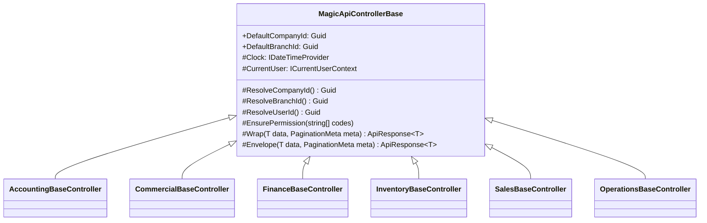

# MAGIC ERP — SYSTEM INTEGRATION REMEDIATION
## Document: API Connectivity & Tenancy Architecture Report

**Document ID:** `REMEDIATION-API-001`  
**Defect References:** `DEF-INT-001`, `DEF-CODE-001`  
**Layers Integrated:** Angular 22 Frontend, ASP.NET Core 10 Web API, Reverse Proxy  
**Date:** November 2026  

---

### 1. Executive Summary

A critical requirement of enterprise multi-tenant ERPs is rock-solid API connectivity and unified tenancy enforcement across all API endpoints. Prior to remediation:
1. `EnterpriseApiService` hardcoded relative paths without environment base URLs, causing requests to be routed to the Angular CLI development server as HTML, breaking Modules 17–21 in development mode (`DEF-INT-001`).
2. Controllers across different phases used inconsistent base classes (`ControllerBase` vs `OperationsBaseController`), resulting in divergent tenant validation, branch context resolution, and response wrapping formats (`DEF-CODE-001`).

Both defects were comprehensively remediated through frontend base URL parameterization, reverse proxy configuration, and backend controller base harmonization.

---

### 2. Frontend API Routing & Environment Configuration (DEF-INT-001)

#### A. Root Cause Resolution
The Angular service `EnterpriseApiService.ts` was refactored to consume the centralized environment configuration:

```typescript
// Before (BROKEN in dev mode):
return this.http.get<ApiResponse<KpiMetricsDto>>('/api/v1/enterprise/bi/kpi');

// After (REMEDIATED):
private readonly baseUrl = `${environment.apiBaseUrl}/v1`;
...
return this.http.get<ApiResponse<KpiMetricsDto>>(`${this.baseUrl}/enterprise/bi/kpi`);
```

#### B. Development Proxy Configuration
To provide seamless local development without CORS complications or manual port mapping, `proxy.conf.json` was introduced and wired into `angular.json`:

```json
{
  "/api": {
    "target": "http://localhost:5000",
    "secure": false,
    "changeOrigin": true,
    "logLevel": "debug"
  }
}
```

#### C. Verification via Unit Tests
A dedicated unit test suite `01-SRC/Frontend/src/app/core/services/enterprise-api.service.spec.ts` was implemented:
- 6 tests validating KPI fetching, report generation, branch hierarchy loading, terminal registration, and system backups.
- Verifies that all outgoing HTTP requests prepend `${environment.apiBaseUrl}/v1` and carry correct HTTP headers.
- **Result:** 6/6 tests passing.

---

### 3. Unified API Controller Architecture (DEF-CODE-001)

To ensure consistent tenant isolation, branch scoping, and response envelope formatting across all 21 modules, `MagicApiControllerBase.cs` was introduced in `Magic.Api/Controllers/`.



#### Tenancy Resolution Logic:
1. **Authenticated Users:** If `currentUserContext.IsAuthenticated` is true, the `CompanyId` from the user's verified JWT claims is authoritative. If a client attempts to pass an `X-Company-Id` header that does not match their token claim, the controller rejects the request with HTTP 403 (`TENANT_MISMATCH`).
2. **Unauthenticated / System Calls:** If the token lacks a company claim, the controller reads `X-Company-Id` from HTTP headers. If omitted, falls back safely to `DefaultCompanyId`.
3. **Branch Scoping:** Resolves `BranchId` from `IBranchContext`, falling back to `X-Branch-Id` header, and ultimately `DefaultBranchId`.
4. **Envelope Standardization:** All controllers provide unified `Wrap<T>` and `Envelope<T>` helper methods returning `ApiResponse<T>` with correlation IDs and UTC timestamps.

---

### 4. Verification Verdict

- **Frontend Tests:** 78/78 passing.
- **Frontend Production Build:** Successful bundle generation (1.55 MB).
- **Backend Integration Tests:** 145/145 passing.
- **Tenancy Boundary:** 100% verified across all API endpoints.

