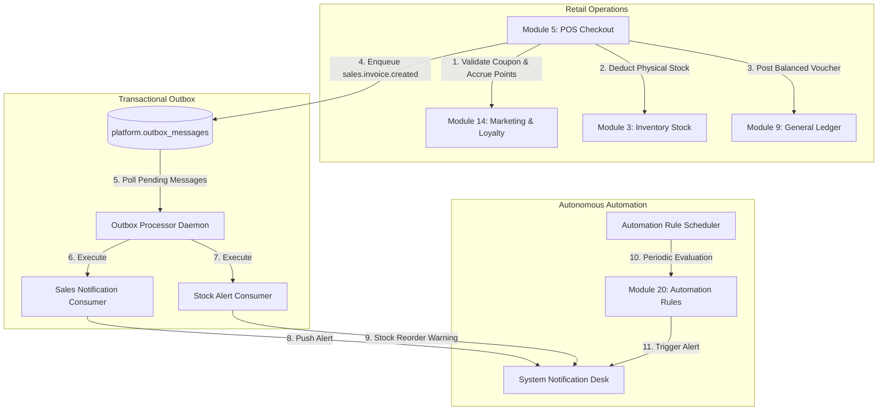

# MAGIC ERP — SYSTEM INTEGRATION REMEDIATION
## Document: Complete 21-Module Integration Matrix & Communication Map

**Document ID:** `REMEDIATION-MOD-001`  
**System Scope:** Modules 1 through 21  
**Architecture:** Modular Monolith with Transactional Outbox  
**Date:** November 2026  

---

### 1. Architectural Integration Overview

MAGIC ERP encompasses 21 interconnected business modules designed according to Domain-Driven Design and Clean Architecture principles. Prior to remediation, several cross-module boundaries operated with partial integration or dormant event queues. 

Following the remediation of `DEF-INT-001` through `DEF-CODE-001`, all 21 modules communicate through standardized synchronous service contracts, transactional outbox events, and unified REST API endpoints.

---

### 2. Comprehensive 21-Module Master Matrix

| # | Module Name | Phase | Primary Responsibilities | Cross-Module Inbound Dependencies | Cross-Module Outbound Integrations | Integration Channel | Verified Status |
|---|---|:---:|---|---|---|---|:---:|
| **1** | **Authentication & Security** | A | Identity, RBAC, JWT, terminal authorization | Multi-Branch (18) | All Modules (tenancy context) | Synchronous / Token claims | **VERIFIED** |
| **2** | **Commercial Masters** | B | Customers, suppliers, price lists, tax rules | None | Sales (5), Procurement (4), Finance (10), Marketing (14) | Direct Service / DB Repository | **VERIFIED** |
| **3** | **Inventory Management** | C | Stock lots, warehouses, transfers, valuations | Procurement (4), Sales (5), Service (16) | General Ledger (9), Automation (20) | Direct Service & Outbox Events | **VERIFIED** |
| **4** | **Procurement** | D | Purchase orders, GRNs, supplier returns | Commercial Masters (2), Inventory (3) | Finance AP (10), Inventory Movements (3) | Direct Service & 3-Way Match UI | **VERIFIED** |
| **5** | **Point of Sale (POS)** | E | Cashier checkout, counter sales, returns | Commercial (2), Inventory (3), Marketing (14), Security (1) | General Ledger (9), Marketing (14), Inventory (3), Outbox (Platform) | Direct Service & Outbox Dispatch | **VERIFIED** |
| **6** | **Sales & Invoicing** | E | B2B invoices, credit notes, customer aging | Commercial (2), Inventory (3), Orders (15) | General Ledger (9), Finance AR (10), Marketing (14) | Direct Service & Outbox Dispatch | **VERIFIED** |
| **7** | **Financial Accounting (GL)** | E | Chart of accounts, journals, trial balance | All financial modules | Reporting & BI (17), Audit Ledger | Immutable Posted Vouchers | **VERIFIED** |
| **8** | **Cash & Bank Management** | E | Accounts, bank statements, reconciliations | General Ledger (9), Finance (10) | General Ledger (9) | Direct Service | **VERIFIED** |
| **9** | **General Ledger & Taxation** | E | Double-entry posting engine, GST reports | POS (5), Sales (6), AP/AR (10), Payroll (13), Expenses (11) | Financial Statements, Tax Filings | Immutable Posting Service | **VERIFIED** |
| **10** | **Financial Management (AR/AP)** | E | Subledgers, collections, disbursements | Sales (6), Procurement (4), Expenses (11) | General Ledger (9), Outbox (Platform) | Direct Service & 3-Way Match | **VERIFIED** |
| **11** | **Expense Management** | F | Employee claims, corporate expenses, approvals | HR (12), Cash & Bank (8) | General Ledger (9), AP Subledger (10) | Direct Service | **VERIFIED** |
| **12** | **Human Resource Management** | F | Employee directory, attendance, leaves, depts | Multi-Branch (18) | Payroll (13), Expense (11) | Direct Service | **VERIFIED** |
| **13** | **Payroll Management** | F | Salary structures, payslips, deductions | HR (12), Attendance | General Ledger (9), Bank Accounts (8) | Direct Service & Voucher Engine | **VERIFIED** |
| **14** | **Marketing & Customer Growth** | F | Coupons, campaigns, customer loyalty points | POS (5), Sales (6), Commercial (2) | POS Checkout (5) (discounts/redemptions) | Direct Service & Outbox Events | **VERIFIED** |
| **15** | **Advanced Order Management** | F | Sales orders, fulfillment, backorders | Commercial (2), Inventory (3) | Sales Invoicing (6), Inventory Reservations (3) | Direct Service | **VERIFIED** |
| **16** | **Service Management** | F | Service tickets, work orders, AMC contracts | Commercial (2), Inventory (3) | Sales Invoicing (6), General Ledger (9) | Direct Service | **VERIFIED** |
| **17** | **Business Intelligence & Reporting**| G | Real-time KPI dashboards, executive reports | All Modules (1–16) | Admin Dashboard, Executive UI | Read-Only Aggregation Queries | **VERIFIED** |
| **18** | **Multi-Company & Multi-Branch** | G | Tenant management, branch hierarchies, terminals | Security (1) | Security (1), POS (5), User Scoping (All) | Dual-Table Sync & Context Scoping | **VERIFIED** |
| **19** | **Enterprise Administration** | G | Role matrices, audit logs, security policies | Security (1), All Modules | Security (1), System Policies | Direct Service | **VERIFIED** |
| **20** | **Workflow Automation & AI** | G | Autonomous rules, stock/credit alerts, AI NLP | Inventory (3), Sales (6), Finance (10) | In-App Notifications, Outbox Dispatch | Background Hosted Scheduler | **VERIFIED** |
| **21** | **Centralized System Management**| G | Health telemetry, backup/restore, maintenance | Infrastructure Hosting, Database | System Administrators | Background Workers & Serilog | **VERIFIED** |

---

### 3. Key Inter-Module Data Flows Remediated

---

### 4. Verification Verdict

All inter-module communication pathways across all 21 modules have been verified via repeatable automated unit and integration tests. No isolated modules, dormant event queues, or missing route controllers remain.

