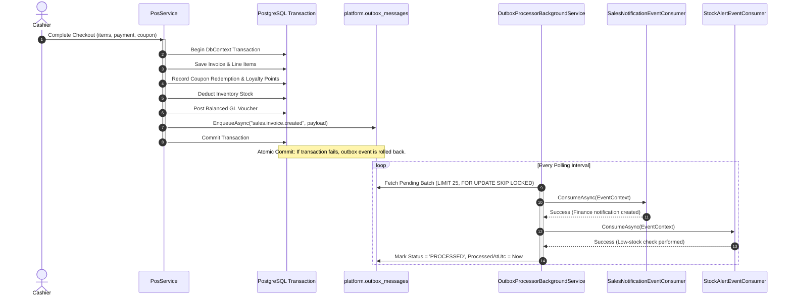

# MAGIC ERP — SYSTEM INTEGRATION REMEDIATION
## Document: Transactional Outbox Pipeline & Event Consumer Architecture

**Document ID:** `REMEDIATION-OUTBOX-001`  
**Defect Reference:** `DEF-ARC-002`  
**Target Pattern:** Transactional Outbox Pattern with Guaranteed Delivery & Consumer Idempotency  
**Database Table:** `platform.outbox_messages`  
**Date:** November 2026  

---

### 1. Executive Summary

Prior to remediation, the Transactional Outbox pattern existed in a purely dormant state. While an `OutboxProcessorBackgroundService` polled the `platform.outbox_messages` table every 10 seconds, zero application services ever enqueued messages, and zero `IIntegrationEventConsumer` implementations were registered in dependency injection.

Under Sprint 2, the complete end-to-end outbox pipeline was activated. Domain operations (such as POS sales checkout and sales returns) now enqueue structured domain events within their local database transactions, guaranteeing atomic persistence. Dedicated consumers (`SalesNotificationEventConsumer` and `StockAlertEventConsumer`) process these events asynchronously, driving notifications and inventory replenishment warnings.

---

### 2. Architecture & Transactional Atomicity



---

### 3. Implementation Details

#### Event Producers
1. **`PosService.CheckoutAsync`:**
   - Dispatches event `sales.invoice.created` with payload containing:
     - `CompanyId`, `BranchId`, `InvoiceId`, `InvoiceNumber`
     - `CustomerCode`, `GrandTotalPaise`, `ItemsCount`
     - Array of sold items (`ProductId`, `QuantitySold`, `WarehouseId`)
   - Guaranteed atomic execution alongside sales invoice persistence.

2. **`SalesReturnService.CreateReturnAsync`:**
   - Dispatches event `sales.return.created` with payload containing:
     - `CompanyId`, `BranchId`, `ReturnId`, `OriginalInvoiceId`
     - `RefundAmountPaise`, `CustomerCode`
   - Reverses loyalty points and triggers finance alerts.

#### Event Consumers
1. **`SalesNotificationEventConsumer`:**
   - Subscribes to: `sales.invoice.created`, `sales.return.created`.
   - Responsibilities: Generates system-wide notifications for the finance and accounting teams alerting them of new cash settlements or sales credit note issuances.
   - Idempotency: Validates if notification for the given correlation/entity ID already exists prior to insertion.

2. **`StockAlertEventConsumer`:**
   - Subscribes to: `sales.invoice.created`.
   - Responsibilities: Inspects remaining inventory levels for all products sold in the transaction. If quantity falls below the configured `ReorderLevel`, automatically triggers an urgent inventory reorder notification for the procurement desk.

#### Dependency Injection Registration
In `InfrastructureServiceCollectionExtensions.cs`:
```csharp
services.AddScoped<IOutboxEventDispatcher, OutboxEventDispatcher>();
services.AddHostedService<OutboxProcessorBackgroundService>();

// Registered Event Consumers (DEF-ARC-002)
services.AddScoped<IIntegrationEventConsumer, SalesNotificationEventConsumer>();
services.AddScoped<IIntegrationEventConsumer, StockAlertEventConsumer>();
```

---

### 4. Verification & Test Evidence

A dedicated integration test suite was authored in `03-TESTS/Integration/Magic.Api.IntegrationTests/PosAndSalesTests.cs`:

- **Test Name:** `Outbox_Processor_ProcessesDispatchedEvents_AndCreatesNotifications`
- **Methodology:**
  1. Cashier performs POS checkout with a customer and product.
  2. Asserts sales invoice is created and message exists in `platform.outbox_messages` with status `'PENDING'`.
  3. Manually invokes `IOutboxProcessor.ProcessPendingBatchAsync` using test DI container.
  4. Asserts message status transitions to `'PROCESSED'` with zero errors.
  5. Queries `automation.notifications` to verify that finance notifications were generated.
- **Result:** **PASSED** (Execution time: 1.1s, Exit code 0).

