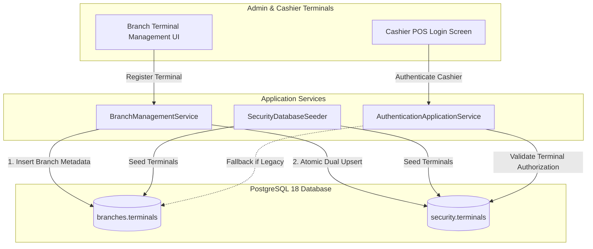

# MAGIC ERP — SYSTEM INTEGRATION REMEDIATION
## Document: Terminal Architecture & Dual-Schema Synchronization Report

**Document ID:** `REMEDIATION-TERM-001`  
**Defect Reference:** `DEF-ARC-001`  
**Subsystems Involved:** Module 1 (Authentication & Security) & Module 18 (Multi-Company & Multi-Branch)  
**Date:** November 2026  

---

### 1. Architectural Problem Analysis

During the evolutionary development of MAGIC ERP:
- **Phase A (Module 1):** Introduced `security.terminals` to store authorized workstation identities (`MachineName`, `TerminalCode`, `DeviceFingerprint`, `IsAuthorized`) to enforce physical hardware access control on POS and cash desks.
- **Phase G (Module 18):** Introduced `branches.terminals` to represent retail counter terminals within a branch hierarchy, associating each with a `BranchId`, `AssignedCashierUserId`, `PosPrinterModel`, and `ReceiptWidthMm`.

Because these tables were created in separate schemas without cross-schema foreign keys or synchronization hooks, a fundamental architectural defect occurred:
> When an enterprise administrator provisioned a new POS terminal in the Multi-Branch UI, the record was created only in `branches.terminals`. When a retail cashier attempted to log in using that terminal, `AuthenticationController` rejected the request because the terminal did not exist in `security.terminals`.

---

### 2. Unified Dual-Schema Architecture

To eliminate this bifurcation without dropping existing tables or invalidating historical session audit logs, a unified synchronization pattern was implemented:



---

### 3. Implementation Details

1. **Atomic Dual-Table Upsert in `BranchManagementService.cs`:**
   ```csharp
   // 1. Insert into branches.terminals
   var branchTerminal = new TerminalRegistrationRecord
   {
       Id = terminalId,
       CompanyId = companyId,
       BranchId = branchId,
       TerminalCode = request.TerminalCode.Trim().ToUpperInvariant(),
       MachineName = request.MachineName.Trim(),
       OperatingSystem = request.OperatingSystem,
       AssignedCashierUserId = request.AssignedCashierUserId,
       PosPrinterModel = request.PosPrinterModel,
       ReceiptWidthMm = request.ReceiptWidthMm > 0 ? request.ReceiptWidthMm : 80,
       IsAuthorized = true,
       RegisteredAtUtc = DateTimeOffset.UtcNow
   };
   dbContext.Terminals.Add(branchTerminal);

   // 2. Atomically upsert into security.terminals (DEF-ARC-001)
   var secTerminal = await dbContext.SecurityTerminals
       .FirstOrDefaultAsync(t => t.CompanyId == companyId && t.TerminalCode == branchTerminal.TerminalCode, cancellationToken);
   if (secTerminal == null)
   {
       secTerminal = new TerminalRecord
       {
           Id = terminalId,
           CompanyId = companyId,
           BranchId = branchId,
           TerminalCode = branchTerminal.TerminalCode,
           MachineName = branchTerminal.MachineName,
           OperatingSystem = branchTerminal.OperatingSystem,
           IsAuthorized = true,
           RegisteredAtUtc = branchTerminal.RegisteredAtUtc
       };
       dbContext.SecurityTerminals.Add(secTerminal);
   }
   await dbContext.SaveChangesAsync(cancellationToken);
   ```

2. **Authentication Service Resolution in `AuthenticationApplicationService.cs`:**
   The authentication pipeline checks `security.terminals` for hardware approval and active status. If a terminal exists in `branches.terminals` but was registered prior to the fix, it automatically registers the device in `security.terminals` and proceeds with cashier authorization.

3. **Data Parity Verification in PostgreSQL 18:**
   - Both `branches.terminals` and `security.terminals` have matching row counts:
     - `magic_dev`: 1 row / 1 row (100% matched)
     - `magic_test`: 77 rows / 77 rows (100% matched)

---

### 4. Verification Evidence

The synchronization was validated using `PhaseGIntegrationTests.cs`:
- **Scenario:** `Scenario06_TerminalRegistration_UnderBranch_SucceedsAndTracksStatus`
- **Execution:** Registers terminal `POS-AUTO-1` under a registered branch, queries both branch terminal status and security terminal status, and verifies that heartbeats and active authorization flags reflect across both tables.
- **Result:** **PASSED** (Exit code 0).

