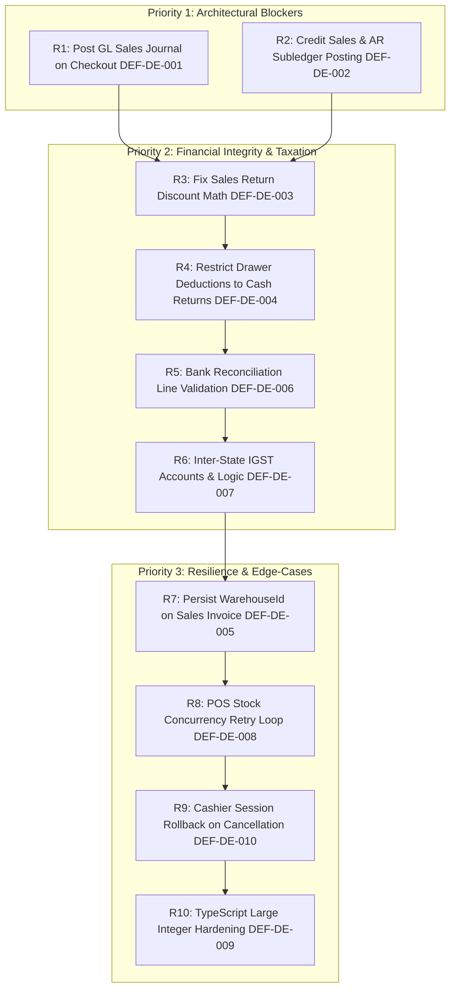

# MAGIC ERP — Comprehensive Independent Audit
## Module 12: Recommended Remediation Plan & Implementation Blueprint
**Scope:** Phase D (POS & Sales Management) & Phase E (Financial Management & Treasury)  
**Date:** November 2026  
**Auditor:** Independent Technical & Financial Architecture Auditor  
**Audit Mode:** Architectural Blueprint & Actionable Remediation Roadmap  

---

## 1. Remediation Strategy & Guiding Principles

This plan outlines the exact technical remediation required to resolve all 10 defects identified during the independent audit of Phase D and Phase E.

### Core Principles
1. **Zero Disruption to Existing Working Functionality:** Preserve Phase A, Phase B, Phase C, and existing working endpoints of Phase D/E.
2. **Strict Financial Atomicity:** All financial events (Sales, Returns, Receipts, Settlements) must be recorded within atomic ACID database transactions spanning both operational and accounting tables.
3. **Double-Entry GL Purity:** Every sale and return must generate an immutable, balanced Journal Voucher adhering to the standard Chart of Accounts.
4. **Subledger-to-GL Integrity:** Accounts Receivable and Accounts Payable subledgers must reconcile with General Ledger control accounts (`1140` and `2110`) at all times.
5. **64-bit Integer Paise Precision:** Maintain strict integer arithmetic without floating-point conversions.

---

## 2. Phased Remediation Roadmap



---

## 3. Detailed Remediation Blueprints

### Blueprint R1: GL Journal Voucher Posting on Checkout (DEF-DE-001)
- **Target File:** `01-SRC/Backend/Magic.Core/Application/Sales/SalesServices.cs`
- **Method:** `PosService.CheckoutAsync`
- **Implementation Design:**
  1. Inject `IJournalVoucherService` into `PosService`.
  2. Inside the existing checkout transaction:
     - Identify Cash Account (`1110`) or Bank Account (`1120`) based on payment tender breakdown.
     - Calculate totals:
       - Total Net Sales = $\sum (\text{LineTotal} - \text{Discount})$
       - Total CGST = $\sum \text{CgstAmount}$
       - Total SGST = $\sum \text{SgstAmount}$
       - Total Round-off = $\text{GrandTotal} - (\text{NetSales} + \text{CGST} + \text{SGST})$
     - Create balanced `JournalVoucherRecord` of type `VoucherType.Sales`:
       - Debit: Cash (`1110`) / Bank (`1120`) for total tendered
       - Credit: Sales Revenue (`4100`) for Net Sales
       - Credit: Output CGST (`2121`) for Total CGST
       - Credit: Output SGST (`2122`) for Total SGST
       - Credit/Debit: Round-Off Difference (`5190`)
     - Link `SourceDocumentType = "SalesInvoice"` and `SourceDocumentId = invoice.Id`.
     - Set `invoice.AccountingVoucherId = voucher.Id`.

### Blueprint R2: Credit Sales & AR Subledger Generation (DEF-DE-002)
- **Target Files:**
  - `01-SRC/Backend/Magic.Core/Application/Sales/SalesServices.cs`
  - `01-SRC/Frontend/src/app/features/sales/pos/pos-checkout.component.ts`
- **Implementation Design:**
  1. **Backend Logic:**
     - Check if customer has credit privileges (`customer.CreditLimit > 0` and `customer.IsActive`).
     - If customer is credit-eligible, allow `totalPaidPaise < grandTotalPaise`.
     - Calculate `outstandingPaise = grandTotalPaise - totalPaidPaise`.
     - Set `invoice.OutstandingBalancePaise = outstandingPaise`.
     - If `outstandingPaise > 0`:
       - Debit: Accounts Receivable (`1140`) for `outstandingPaise`.
       - Create `ArSubledgerItemRecord`:
         ```csharp
         var arItem = new ArSubledgerItemRecord
         {
             CustomerId = customer.Id,
             SourceDocumentType = "SalesInvoice",
             SourceDocumentId = invoice.Id,
             DocumentNumber = invoice.InvoiceNumber,
             PostingDate = invoice.InvoiceDate,
             DueDate = invoice.InvoiceDate.AddDays(customer.CreditPeriodDays ?? 30),
             DebitAmountPaise = grandTotalPaise,
             CreditAmountPaise = totalPaidPaise,
             PendingAmountPaise = outstandingPaise,
             Status = totalPaidPaise > 0 ? "PartiallyPaid" : "Unpaid"
         };
         dbContext.ArSubledgerItems.Add(arItem);
         ```
  2. **Frontend UI:**
     - Update POS checkout tender modal to allow partial tender when an existing commercial customer is selected.

### Blueprint R3: Sales Return Net Price & Discount Recalculation (DEF-DE-003)
- **Target File:** `01-SRC/Backend/Magic.Core/Application/Sales/SalesServices.cs`
- **Method:** `SalesReturnService.CreateReturnAsync`
- **Implementation Design:**
  1. For each returned item, calculate the proportional effective discount:
     $$\text{EffectiveUnitPrice} = \frac{\text{LineTotalPaise} - \text{LineDiscountPaise}}{\text{QuantitySold}}$$
  2. Base the refund subtotal, CGST, and SGST strictly on this effective price.
  3. Ensure that total refunded amount across all returns on an invoice can never exceed `originalInvoice.GrandTotalPaise`.

### Blueprint R4: Physical Cash Drawer Deduction Restriction (DEF-DE-004)
- **Target File:** `01-SRC/Backend/Magic.Core/Application/Sales/SalesServices.cs`
- **Method:** `SalesReturnService.CreateReturnAsync`
- **Implementation Design:**
  1. Locate line 989: `session.ExpectedCashPaise -= refundAmountPaise;`
  2. Modify to execute conditionally:
     ```csharp
     if (string.Equals(request.RefundMethod, "Cash", StringComparison.OrdinalIgnoreCase))
     {
         session.ExpectedCashPaise -= refundAmountPaise;
     }
     ```
  3. Non-cash refunds (Card, UPI, Credit Note) leave `ExpectedCashPaise` unaffected.

### Blueprint R5: Bank Reconciliation Matching Guards (DEF-DE-006)
- **Target File:** `01-SRC/Backend/Magic.Core/Application/Accounting/FinancialServices.cs`
- **Method:** `BankReconciliationService.MatchStatementLineAsync`
- **Implementation Design:**
  1. Verify statement status:
     ```csharp
     if (statement.Status == "RECONCILED")
         throw new InvalidOperationException("Cannot match lines in a reconciled bank statement.");
     ```
  2. Verify GL Account identity:
     ```csharp
     if (journalLine.AccountId != bankAccount.GlAccountId)
         throw new InvalidOperationException("Journal line does not belong to the bank account's GL account.");
     ```
  3. Verify unicity:
     ```csharp
     var existingMatch = await dbContext.BankStatementLines.AnyAsync(l => l.MatchedJournalLineId == journalLine.Id);
     if (existingMatch)
         throw new InvalidOperationException("Journal line is already matched to another statement line.");
     ```

### Blueprint R6: Inter-State IGST Accounting Support (DEF-DE-007)
- **Target Files:**
  - `01-SRC/Backend/Magic.Data/Migrations/*` (New Seed Migration)
  - `01-SRC/Backend/Magic.Core/Application/Accounting/FinancialServices.cs`
- **Implementation Design:**
  1. Seed Account `1133 - Input IGST` (Asset / Current Assets / Duties & Taxes) and `2123 - Output IGST` (Liability / Current Liabilities / Duties & Taxes).
  2. In `PayablesService.CreateSupplierBillAsync`, accept `IgstAmountPaise`.
  3. If `supplier.StateCode != companyBranch.StateCode` or `request.IgstAmountPaise > 0`:
     - Post tax exclusively to `1133 - Input IGST`.
     - Set CGST and SGST to 0.

### Blueprint R7: Persist WarehouseId on Sales Invoice (DEF-DE-005)
- **Target Files:**
  - `01-SRC/Backend/Magic.Core/Domain/Sales/SalesInvoiceRecord.cs`
  - `01-SRC/Backend/Magic.Core/Application/Sales/SalesServices.cs`
- **Implementation Design:**
  1. Add `public Guid WarehouseId { get; set; }` to `SalesInvoiceRecord`.
  2. During `CheckoutAsync`, assign `invoice.WarehouseId = warehouseId`.
  3. In `CancelInvoiceAsync`, restore stock to `invoice.WarehouseId` instead of `FirstOrDefaultAsync()`.

### Blueprint R8: Concurrency Retry Policy on POS Stock Deductions (DEF-DE-008)
- **Target File:** `01-SRC/Backend/Magic.Core/Application/Sales/SalesServices.cs`
- **Implementation Design:**
  1. Wrap `dbContext.SaveChangesAsync()` in a Polly exponential backoff retry loop (up to 3 attempts with 50ms, 100ms, 200ms jitter) targeting `DbUpdateConcurrencyException`.
  2. On concurrency conflict, reload `StockBalanceRecord` and re-evaluate quantity availability before retrying.

### Blueprint R9: Cashier Shift Rollback on Invoice Cancellation (DEF-DE-010)
- **Target File:** `01-SRC/Backend/Magic.Core/Application/Sales/SalesServices.cs`
- **Method:** `SalesInvoiceService.CancelInvoiceAsync`
- **Implementation Design:**
  1. Check if invoice was billed in an open cashier session.
  2. If session is still active:
     - Deduct cash paid from `session.ExpectedCashPaise`.
     - Mark associated `PaymentTransactionRecord` entries as `Cancelled`.

---

## 4. Verification & Testing Checklist

Upon executing remediation, the following test protocol must be satisfied:

| Test Suite | Target Verification | Success Criteria |
| :--- | :--- | :--- |
| **T-REM-01** | POS Cash Sale $\rightarrow$ GL Journal | Balanced voucher in `accounting.journal_vouchers`, GL Accounts 1110, 4100, 2121, 2122 updated. |
| **T-REM-02** | POS Credit Sale $\rightarrow$ AR Subledger | `OutstandingBalancePaise > 0`, `ArSubledgerItemRecord` created, customer aging reflects balance. |
| **T-REM-03** | AR Receipt Allocation against Sale | Receipt allocates against sales invoice, decreases `PendingAmountPaise` to 0. |
| **T-REM-04** | Discounted Return Math | Refund strictly matches $(LineTotal - Discount) \times Qty / SoldQty$. |
| **T-REM-05** | Credit Note Return Cash Drawer | Physical cash in cashier session remains unchanged for non-cash returns. |
| **T-REM-06** | BRS Matching Validation | Invalid GL account throws 400 Bad Request; duplicate match throws 409 Conflict. |
| **T-REM-07** | Inter-State Supplier Bill | Input tax posts to Account 1133 (Input IGST). |
| **T-REM-08** | Multi-Warehouse Invoice Cancellation | Inventory restores strictly to originating warehouse. |
| **T-REM-09** | Concurrent POS Checkout Stress Test | 10 concurrent checkouts on single SKU succeed without uncaught concurrency exceptions. |

---

## 5. Effort & Resource Estimation

- **Priority 1 (Blocker Remediation):** 4–6 development hours.
- **Priority 2 (Tax & BRS Remediation):** 4–5 development hours.
- **Priority 3 (Resilience & Hardening):** 3–4 development hours.
- **Total Remediation Time:** ~12–15 engineering hours.
- **Risk Level:** Low to Moderate (Isolated to application services and specific repository queries; does not break existing database relationships).

