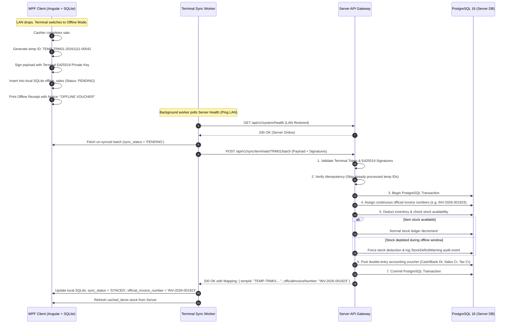

# MAGIC — TERMINAL OFFLINE SQLITE BUFFERING & SYNCHRONIZATION SPECIFICATION

**Document Version:** 1.0.0  
**Status:** PROPOSED ARCHITECTURE ONLY (Under Active Comparative Evaluation — Not Formally Approved)  
**Last Updated:** 2026-11-11  

---

> [!WARNING]
> **PROPOSED ARCHITECTURE ONLY**  
> This specification details the theoretical mechanics of Local SQLite Buffering and Synchronization for client terminals. It is currently under architectural review against Strict Online LAN operation. Neither approach is considered approved until explicit confirmation by the project sponsor.

---

## 1. Architectural Motivation & Tenets

In a high-velocity retail or distribution environment, checkout counters must **never stop processing sales**. Network disruptions (LAN switch failure, Wi-Fi drops, server reboots) cannot be allowed to freeze cashier operations.

Under this **proposed model for Local SQLite Buffering**, each MAGIC client terminal would operate with an embedded local **SQLite** database acting as an offline read-cache and transactional outbox.

### Core Tenets
1. **Zero Cashier Interruption:** If the LAN connection to the primary in-store server drops, the POS interface transitions seamlessly to *Offline Mode* without blocking the cashier.
2. **Deterministic Sequence Numbering:** Offline transactions are tagged with unambiguous temporary sequence numbers (`TEMP-{TerminalId}-{Date}-{Seq}`) and mapped to official continuous fiscal invoice numbers upon sync.
3. **Cryptographic Tamper-Proofing:** Every buffered transaction is signed with the terminal's private **Ed25519** key before storage in the local SQLite database. The server rejects any synced record whose signature fails verification.
4. **Idempotent Batch Reconciliation:** The sync protocol is fully idempotent. Network failures during a sync push will never result in duplicate billing, duplicate stock drops, or duplicate accounting vouchers.
5. **Business-First Conflict Resolution:** If an item is sold offline while being depleted on the server by another terminal, the sale is accepted by the server (the customer has physically paid and departed). The system generates the official invoice, posts the journal voucher, and flags an immediate `StockDeficitWarning` for supervisor inventory audit.

---

## 2. Terminal Local SQLite Schema Design (`magic_terminal_cache.db`)

The local SQLite database is encrypted using **SQLCipher (AES-256)** with the encryption key derived from the Windows Data Protection API (DPAPI) tied to the machine's local service account.

```sql
-- Read-Only Cached Masters (Refreshed periodically from Server when online)
CREATE TABLE cached_items (
    item_id TEXT PRIMARY KEY, -- UUID string
    sku TEXT NOT NULL,
    barcode TEXT NOT NULL,
    item_name TEXT NOT NULL,
    unit_code TEXT NOT NULL,
    hsn_code TEXT NOT NULL,
    selling_price_paise INTEGER NOT NULL,
    mrp_paise INTEGER NOT NULL,
    gst_rate_bps INTEGER NOT NULL,
    is_tax_inclusive INTEGER NOT NULL DEFAULT 1,
    cached_stock_quantity REAL NOT NULL DEFAULT 0,
    last_synced_at TEXT NOT NULL
);

CREATE INDEX ix_cached_items_barcode ON cached_items(barcode);
CREATE INDEX ix_cached_items_sku ON cached_items(sku);

-- Offline Transactional Queue (Outbox to Server)
CREATE TABLE offline_sales (
    temp_invoice_id TEXT PRIMARY KEY, -- e.g., 'TEMP-TRM01-20261111-00042'
    terminal_id TEXT NOT NULL,
    branch_id TEXT NOT NULL,
    cashier_user_id TEXT NOT NULL,
    created_at_local TEXT NOT NULL,
    customer_id TEXT,
    customer_phone TEXT,
    subtotal_taxable_paise INTEGER NOT NULL,
    cgst_paise INTEGER NOT NULL,
    sgst_paise INTEGER NOT NULL,
    igst_paise INTEGER NOT NULL,
    round_off_paise INTEGER NOT NULL,
    grand_total_paise INTEGER NOT NULL,
    tender_type TEXT NOT NULL, -- 'CASH', 'CARD', 'UPI', 'SPLIT'
    tender_received_paise INTEGER NOT NULL,
    change_given_paise INTEGER NOT NULL,
    cryptographic_signature TEXT NOT NULL, -- Ed25519 signature over payload
    sync_status TEXT NOT NULL CHECK (sync_status IN ('PENDING', 'SYNCING', 'SYNCED', 'CONFLICT')),
    official_invoice_id TEXT,             -- Populated once server confirms sync
    official_invoice_number TEXT,         -- e.g., 'INV-2026-001923'
    synced_at_utc TEXT
);

CREATE TABLE offline_sale_items (
    id INTEGER PRIMARY KEY AUTOINCREMENT,
    temp_invoice_id TEXT NOT NULL REFERENCES offline_sales(temp_invoice_id),
    line_number INTEGER NOT NULL,
    item_id TEXT NOT NULL,
    batch_number TEXT,
    quantity REAL NOT NULL,
    unit_price_paise INTEGER NOT NULL,
    taxable_amount_paise INTEGER NOT NULL,
    gst_rate_bps INTEGER NOT NULL,
    cgst_paise INTEGER NOT NULL,
    sgst_paise INTEGER NOT NULL,
    igst_paise INTEGER NOT NULL,
    line_total_paise INTEGER NOT NULL
);

CREATE TABLE offline_sale_payments (
    id INTEGER PRIMARY KEY AUTOINCREMENT,
    temp_invoice_id TEXT NOT NULL REFERENCES offline_sales(temp_invoice_id),
    payment_mode TEXT NOT NULL,
    amount_paise INTEGER NOT NULL,
    reference_number TEXT
);
```

---

## 3. Synchronization Protocol & Workflow



---

## 4. Conflict Resolution Matrix

| Conflict Scenario | Resolution Rule | Accounting & Audit Action |
|---|---|---|
| **Inventory Depleted on Server While Offline** | **Accept Offline Sale:** Customer has already received goods. Deduct stock into negative or zero. | System posts standard sales journal and writes an alert to `inventory.stock_deficit_alerts` for manager cycle count. |
| **Price Changed on Server While Offline** | **Honor Offline Price:** The price quoted to and paid by the customer is legally binding. | Sale recorded at the cached price. Margin variance is absorbed into standard gross profit reporting. |
| **Duplicate Sync Push on Network Timeout** | **Idempotent Acknowledgment:** Server detects `temp_invoice_id` already exists in sync register. | Server immediately returns the previously assigned `official_invoice_number` without re-posting stock or accounting. |
| **Customer Credit Limit Exceeded** | **Flag for Supervisor Review:** Offline credit sales are restricted to pre-approved offline allowance. | Transaction posted; customer account flagged as over-limit with immediate notification to credit controller. |

---

## 5. Security Invariants for Offline Data

1. **Terminal Token Binding:** The terminal's public key is registered in `organization.terminals` during initial terminal pairing. All offline batches must verify against this registered key.
2. **No Cashier SQLite Access:** The SQLite database file resides in protected system application data (`%ProgramData%\MAGIC\Data`), inaccessible to non-administrative Windows user accounts.
3. **Audit Log of Sync Events:** Every sync batch logs total transactions ingested, duration, and any stock warnings in `audit.system_audit_logs`.

