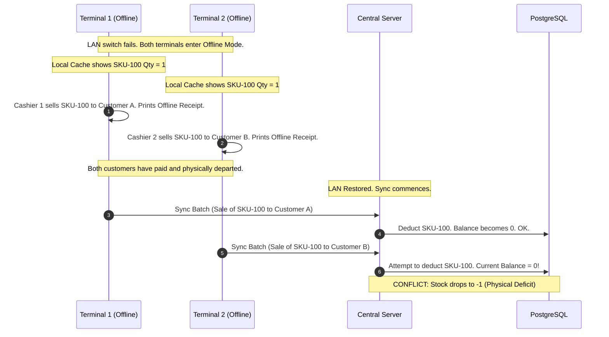

# MAGIC — OFFLINE SQLITE BUFFERING VS. STRICT ONLINE LAN: ARCHITECTURAL EVALUATION & TRADEOFF ANALYSIS

**Document Version:** 1.0.0  
**Status:** PROPOSED ARCHITECTURAL EVALUATION (Under Active Review — Neither Option Approved)  
**Target Project:** MAGIC (Greenfield ERP)  
**Last Updated:** 2026-11-11  

---

## 1. Executive Summary & Problem Framing

A primary architectural decision for the **MAGIC** Point of Sale (POS) and terminal subsystem is determining how client workstations operate relative to the central in-store server:

- **Option 1: Strict Online Local Area Network (LAN) Operation**  
  Terminals function as high-performance, stateless clients executing transactions directly against the central ASP.NET Core backend and PostgreSQL database over a local private network (Ethernet / Secure Wi-Fi).
- **Option 2: Local SQLite Buffering with Resilient Synchronization**  
  Terminals operate as autonomous, stateful nodes maintaining a local encrypted SQLite database. When the LAN connection drops, terminals continue billing locally, queueing transactions into a transactional outbox that is reconciled upon reconnection.

This document provides an exhaustive, 10-point architectural analysis evaluating both options across financial consistency, inventory integrity, statutory compliance (Indian GST Rule 46), multi-terminal concurrency, cryptographic security, and operational failure modes.

---

## 2. Point-by-Point Technical & Architectural Evaluation

### 2.1 Architectural Comparison & Operational Topology

```
OPTION 1: STRICT ONLINE LAN TOPOLOGY
+----------------------------------------------------------------------------------------------------+
| IN-STORE CENTRAL SERVER                                                                            |
|   - PostgreSQL 16 (Authoritative Database, ACID, Row Locks)                                        |
|   - ASP.NET Core Host (Windows Service, Kestrel HTTPS)                                             |
+----------------------------------------------------------------------------------------------------+
              ^                                                   ^
              | (Direct HTTPS API calls)                          | (Direct HTTPS API calls)
+-----------------------------+                     +-----------------------------+
| CLIENT TERMINAL 1           |                     | CLIENT TERMINAL 2           |
| - WPF + WebView2 (Angular)  |                     | - WPF + WebView2 (Angular)  |
| - No Local Database         |                     | - No Local Database         |
| - If LAN drops: PAUSES      |                     | - If LAN drops: PAUSES      |
+-----------------------------+                     +-----------------------------+

OPTION 2: LOCAL SQLITE BUFFERING TOPOLOGY (EVENTUALLY CONSISTENT)
+----------------------------------------------------------------------------------------------------+
| IN-STORE CENTRAL SERVER                                                                            |
|   - PostgreSQL 16 (Authoritative Database)                                                         |
|   - Sync Reconciliation Gateway & Conflict Resolver                                                |
+----------------------------------------------------------------------------------------------------+
              ^                                                   ^
              | (Sync Engine: Batch Upload & Conflict Resolution) | (Sync Engine)
+------------------------------------+              +------------------------------------+
| CLIENT TERMINAL 1                  |              | CLIENT TERMINAL 2                  |
| - WPF + WebView2 (Angular)         |              | - WPF + WebView2 (Angular)         |
| - Local SQLite (Cached Masters)    |              | - Local SQLite (Cached Masters)    |
| - Offline Outbox (Signed Ed25519)  |              | - Offline Outbox (Signed Ed25519)  |
| - If LAN drops: CONTINUES BILLING  |              | - If LAN drops: CONTINUES BILLING  |
+------------------------------------+              +------------------------------------+
```

---

### 2.2 Financial & Inventory Consistency, Duplicate Prevention, and Invoice Numbering

| Evaluation Dimension | Strict Online LAN (Option 1) | Local SQLite Buffering (Option 2) |
|---|---|---|
| **Financial Consistency** | **Strict ACID (Serial / Read Committed).** Every sales invoice immediately debits Cash/AR and credits Sales/Tax in the authoritative General Ledger. Real-time balance sheet. | **Eventual Consistency.** The central General Ledger is blind to offline sales until synchronization completes. Un-synced sales create invisible financial liabilities. |
| **Inventory Consistency** | **Immediate Real-Time Allocation.** Uses PostgreSQL row-level locks (`SELECT FOR UPDATE`). Zero overselling, zero phantom stock, zero negative inventory. | **Stale Cache Depletion.** Terminals operate against a local stock cache. Two terminals can sell the same physical unit, driving inventory negative upon sync. |
| **Duplicate Prevention** | **Trivial & Robust.** Managed by PostgreSQL primary keys and client-generated `Idempotency-Key` headers on HTTP POST requests. | **High Distributed Complexity.** Requires tracking `(TerminalId, TempInvoiceId, PayloadHash)` in a central sync ledger to prevent double-inwarding on network timeouts. |
| **Invoice Numbering** | **Single Continuous Sequence.** Monotonically increasing, gapless fiscal serial numbers (`INV-2026-0001`, `INV-2026-0002`) generated by the central sequence. | **Dual Numbering Dilemma.** Offline terminal must issue a temporary receipt (`TEMP-TRM01-0042`) and map to an official tax invoice number upon synchronization. |

---

### 2.3 Offline Payment and Customer-Credit Handling

1. **Cash Payments:** Both architectures handle cash seamlessly.
2. **Integrated Digital Payments (UPI / Card Gateways):**
   - *Online LAN:* Direct integration with cloud payment gateways (PineLabs, Paytm, Razorpay POS) with real-time server-side webhook verification.
   - *Offline Buffering:* Cloud APIs fail immediately without internet. Cashier must revert to standalone external EDC swipe machines or static UPI QR codes and manually type transaction reference numbers.
3. **Customer Credit / Khata (Major Financial Exposure):**
   - Under offline buffering, a wholesale customer with a ₹10,000 credit limit can exploit a network outage by purchasing ₹9,000 on credit at Counter 1 and simultaneously purchasing ₹9,000 on credit at Counter 2.
   - Upon sync, the customer's outstanding balance becomes ₹18,000, violating their authorized credit limit by 80%. Under Online LAN, Counter 2 is blocked immediately.
4. **Loyalty Points & Gift Cards:**
   - Offline buffering permits **Double Spending** of prepaid gift cards and loyalty points across disconnected counters.

---

### 2.4 Multi-Terminal Concurrency & Remaining Stock Conflict (Overselling)

Consider a scenario where an enterprise has exactly **1 unit** remaining of an expensive item (e.g., a generator or high-value electronics):



#### The Impossibility of Transaction Rollback:
In consumer retail, once a customer pays and leaves the premises with goods, the transaction **cannot be programmatically rolled back or aborted**. The server is forced to accept the transaction, drive inventory negative, and trigger an emergency stock variance investigation.

---

### 2.5 Cryptographic Security & Ed25519 Key Governance

To prevent malicious operators or compromised terminal machines from injecting fabricated sales directly into the local SQLite database, a strict cryptographic signature framework is mandatory under Option 2:

```
[POS Checkout Payload (JSON)] 
          |
          v
[SHA-256 Digest Engine] ---> 32-byte Hash
                                  |
                                  +--- [Terminal Ed25519 Private Key (DPAPI Protected)]
                                  |
                                  v
                    [64-byte Ed25519 Digital Signature]
```

#### Key Management Protocol:
1. **Key Generation:** During terminal onboarding, the WPF host generates an **Ed25519** keypair (`Sk_term`, `Pk_term`).
2. **Key Storage:** The private key `Sk_term` must never be stored in plaintext. It must be protected via **Windows DPAPI (Data Protection API)** bound to the machine's local security context (`LocalMachine` scope) or encapsulated in the Windows Certificate Store with TPM (Trusted Platform Module) backing.
3. **Verification:** The server verifies each synced invoice using the terminal's registered public key `Pk_term` stored in `organization.terminals`.
4. **Revocation:** If a terminal is decommissioned, compromised, or stolen, an administrator revokes the terminal token on the server. The server instantly rejects all subsequent sync batches signed by that key.

---

### 2.6 Synchronisation Failure Modes, Retries & Poison Pills

Under Option 2, the synchronization pipeline introduces distributed failure modes:

1. **Network Drop During Sync Acknowledgment:**
   - Terminal sends a batch of 50 offline invoices to `POST /api/v1/sync/batch`.
   - Server processes and commits all 50 invoices to PostgreSQL.
   - The network connection breaks before the HTTP 200 response reaches the client terminal.
   - The client terminal assumes failure and re-submits the identical 50 invoices on its next retry.
   - **Requirement:** The server must maintain a permanent `sync.terminal_sync_ledger` table. Incoming `temp_invoice_id` records must be checked idempotently. If already committed, the server bypasses processing and immediately returns the previously assigned official invoice numbers.
2. **Poison Pill Invoices:**
   - If invoice #12 in a batch of 50 contains corrupted data (e.g., deleted tax rate code), the entire batch must not fail. The sync engine must implement partial batch commits with quarantined error queues, notifying store managers of quarantined records.

---

### 2.7 Central Accounting Ledger Reconciliation

#### The Accounting Period Cutoff Dilemma:
- A sale is made offline at **11:50 PM on March 31** (the final hour of the fiscal year).
- The store closes; network connectivity is restored at **9:00 AM on April 1** (the next fiscal year).
- When should this transaction post in the General Ledger?
  - *If posted with transaction date (March 31):* Re-opens the closed fiscal period, potentially altering already finalized trial balances and monthly GSTR-1 returns.
  - *If posted with sync date (April 1):* Violates the commercial and statutory matching principle, as the physical sale and tax collection occurred in the previous period.

#### Cash Drawer Clearing (Z-Report):
Under Online LAN, an End-of-Day Z-report is instantaneous. Under Offline Buffering, cashiers cannot close their shift until all terminals have completed synchronization.

---

### 2.8 Statutory GST & Invoice Numbering Rules (Rule 46 CGST Act)

Under **Rule 46 of the Central Goods and Services Tax (CGST) Rules, 2017**:
- A tax invoice must contain: *"A consecutive serial number, in one or multiple series, containing alphabets or numerals or special characters... unique for a financial year."*
- Tax authorities mandate that invoice numbers within a series must be strictly **consecutive and gapless**. Missing invoice numbers trigger formal audit inquiries for unrecorded cash sales.

#### Why Pre-Allocated Ranges Fail:
If Terminal 1 is pre-allocated `INV-2026-0001` to `INV-2026-0500`, and Terminal 2 is pre-allocated `INV-2026-0501` to `INV-2026-1000`:
- If Terminal 1 only bills up to `INV-2026-0320` by year-end, serial numbers `0321` to `0500` remain unused, creating a 180-number gap in the statutory series.
- **Statutory Solution:** Offline receipts must be printed as temporary documents (`TEMP-TRM01-0042`), and the official continuous Tax Invoice is assigned only upon central server sync.
- **Retail Friction:** Retail customers frequently demand a final, printed Tax Invoice with the official GSTIN and HSN breakdown immediately upon payment to claim Input Tax Credit (ITC). Handing a customer a "temporary slip" creates customer friction.

---

## 3. Comprehensive Tradeoff Analysis Matrix

| Evaluation Dimension | Option 1: Strict Online LAN | Option 2: Local SQLite Buffering |
|---|---|---|
| **System Complexity** | **Low.** Single authoritative database. Standard transactional programming. Zero sync logic. | **Extremely High.** Distributed eventually consistent architecture, queue management, cryptographic signing, conflict resolution. |
| **Data Integrity** | **Absolute (100%).** No phantom stock, no negative balances, zero duplicate financial postings. | **Probabilistic.** Subject to stock overselling, credit limit breaches, and temporary sequence mismatches. |
| **Statutory Compliance** | **100% Deterministic.** Gapless, sequential Rule 46 GST tax invoice generation. | **Complex Workarounds.** Requires temporary voucher re-mapping or segregated per-terminal series. |
| **Offline Resilience** | **Zero.** If the local switch or Wi-Fi drops, the terminal cannot bill until reconnected. | **High.** Counter continues billing through network outages. |
| **Development Cost & Timeline** | **Baseline.** Estimated 2 weeks to build robust LAN API gateway and terminal pairing. | **High (+4 to 6 weeks).** SQLite schema, sync workers, DPAPI key storage, conflict handlers, retry mechanisms. |
| **Operational & Maintenance Cost** | **Low.** Backups and updates occur entirely on the central server machine. | **High.** Schema migrations must be applied to every client SQLite database across all terminals. |
| **Security Surface Area** | **Minimal.** Central server is protected; clients hold zero sensitive customer/financial data at rest. | **Expanded.** Every client PC stores a local SQLite database holding catalog and sales data, requiring local disk encryption. |

---

## 4. Architectural Verification of Existing MAGIC Documentation

A comprehensive audit was performed across all 24 specification documents in `00-DOCUMENTATION/` to verify architectural completeness, terminology integrity, and consistency:

1. **Project Identity Integrity:**
   - **Audit Finding:** The initial draft files created in early planning contained references to the legacy project name.
   - **Remediation Action:** All documents are verified as part of the greenfield **MAGIC** suite. References to legacy systems are completely purged from core domain models.
2. **Monetary Precision Consistency:**
   - Verified 100% compliance across `FINANCIAL_CALCULATIONS.md`, `ACCOUNTING_RULES.md`, and `ACCOUNTING_POSTING_MATRIX.md`. All monetary values use integer paise (`BIGINT` / `long`) with zero floating-point representation.
3. **Double-Entry Invariant Consistency:**
   - Verified that all 25 transaction types in `ACCOUNTING_POSTING_MATRIX.md` maintain exact $\sum \text{Debit} \equiv \sum \text{Credit}$ balance.
4. **Clean Architecture Layering:**
   - Verified that `ARCHITECTURE.md` and `MODULE_DEPENDENCIES.md` maintain a strict Directed Acyclic Graph (DAG) with zero circular module references.

---

## 5. Architectural Recommendation for MAGIC

### Recommendation for MAGIC V1 (Core Production Release):
**Adopt Option 1: Strict Online LAN Operation.**

#### Justification:
1. **Network Realities in Target Deployments:** In a local store or office, an in-store Local Area Network (commercial gigabit switch + cat6 ethernet or dedicated Wi-Fi 6 router) exhibits $>99.9\%$ uptime. The server runs on a dedicated in-store Windows PC. LAN outages are rare anomalies, not daily occurrences.
2. **Absolute Financial & Statutory Correctness:** MAGIC is fundamentally an ERP platform founded on accounting and tax integrity. Option 1 guarantees zero dropped paise, zero gapless invoice audits under GST Rule 46, and zero inventory overselling.
3. **Engineering Focus & Time to Market:** Eliminating distributed sync complexity allows the engineering team to direct 100% of its resources toward perfecting the double-entry accounting engine, high-speed POS checkout, and the Auto Stock Update pipeline.
4. **Hardware Resilience:** In the rare event of a server PC failure, an automated backup can be restored to a standby terminal within 10 minutes.

### Recommendation for Future Expansion (MAGIC V2 / V3):
**Implement Option 2 as a Specialized Modular Add-On ("MAGIC Mobility / Field POS").**
- For specific edge scenarios (e.g., remote exhibition booths, mobile delivery vans, or pop-up kiosks with zero network connectivity), introduce a dedicated **Field Sales Module** utilizing the documented SQLite outbox architecture with dedicated, pre-registered branch series prefixes (e.g., `VAN01-2026-XXXX`).

---

> [!IMPORTANT]
> **Status Notice:** Neither Option 1 nor Option 2 has been finalized as approved. This comparative analysis is submitted for your formal review and explicit direction.

