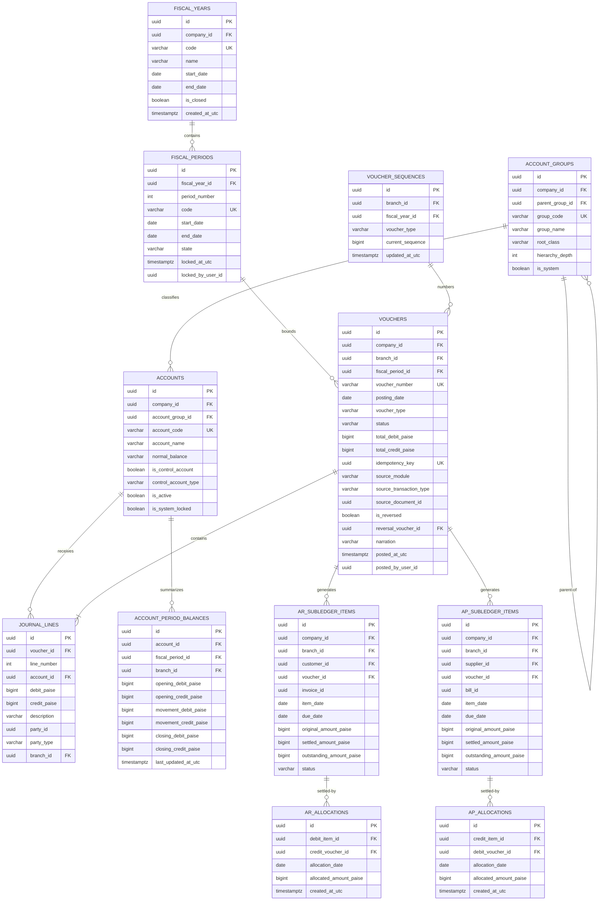

# MAGIC — Phase 2: Accounting Foundation
## Database Architecture & Logical Schema Design

**Document Version:** 2.0.0-DRAFT  
**Phase:** 2 — Accounting Foundation  
**Stage:** 1 — Architecture and Database Design  
**Implementation Status:** NOT AUTHORIZED (Proposed Specification Only — No Migrations Executed)  
**Author:** Antigravity AI & Architecture Team  
**Last Updated:** 2026-11-12  

---

## 1. Relational Database Strategy

The accounting system is housed within the isolated PostgreSQL logical schema: **`accounting`**.  
All financial values are strictly modeled using signed 64-bit integers (`BIGINT` in PostgreSQL), representing amounts in integer paise (₹1.00 = 100 paise). Floating-point data types (`FLOAT`, `REAL`, `DOUBLE PRECISION`) are prohibited.

---

## 2. Entity Relationship Diagram (Mermaid ERD)

---

## 3. Proposed Table Specifications

### 3.1 Table: `accounting.fiscal_years`
- **Purpose:** Represents annual accounting and tax cycles (e.g. 1 April 2026 to 31 March 2027).
- **Primary Key:** `id UUID` (UUIDv7)
- **Data Ownership:** Accounting Module
- **Columns:**
  - `id UUID NOT NULL`
  - `company_id UUID NOT NULL`
  - `code VARCHAR(20) NOT NULL` (e.g. `"FY-2026-27"`)
  - `name VARCHAR(50) NOT NULL` (e.g. `"Financial Year 2026-2027"`)
  - `start_date DATE NOT NULL`
  - `end_date DATE NOT NULL`
  - `is_closed BOOLEAN NOT NULL DEFAULT FALSE`
  - `created_at_utc TIMESTAMPTZ NOT NULL DEFAULT CLOCK_TIMESTAMP()`
- **Constraints:**
  - `pk_fiscal_years PRIMARY KEY (id)`
  - `uq_fiscal_years_company_code UNIQUE (company_id, code)`
  - `chk_fiscal_years_dates CHECK (end_date > start_date)`
- **Indexes:**
  - `ix_fiscal_years_company_dates ON (company_id, start_date, end_date)`

---

### 3.2 Table: `accounting.fiscal_periods`
- **Purpose:** Monthly operational accounting sub-periods subject to chronological locking.
- **Primary Key:** `id UUID` (UUIDv7)
- **Data Ownership:** Accounting Module
- **Columns:**
  - `id UUID NOT NULL`
  - `fiscal_year_id UUID NOT NULL REFERENCES accounting.fiscal_years(id) ON DELETE RESTRICT`
  - `period_number INT NOT NULL` (1 to 12)
  - `code VARCHAR(20) NOT NULL` (e.g. `"2026-04"`)
  - `start_date DATE NOT NULL`
  - `end_date DATE NOT NULL`
  - `state VARCHAR(20) NOT NULL DEFAULT 'OPEN'` (`OPEN`, `CLOSING`, `LOCKED`)
  - `locked_at_utc TIMESTAMPTZ`
  - `locked_by_user_id UUID`
- **Constraints:**
  - `pk_fiscal_periods PRIMARY KEY (id)`
  - `uq_fiscal_periods_year_period UNIQUE (fiscal_year_id, period_number)`
  - `chk_fiscal_periods_state CHECK (state IN ('OPEN', 'CLOSING', 'LOCKED'))`
  - `chk_fiscal_periods_dates CHECK (end_date >= start_date)`
- **Indexes:**
  - `ix_fiscal_periods_dates ON (start_date, end_date)`

---

### 3.3 Table: `accounting.account_groups`
- **Purpose:** Hierarchical taxonomy for account aggregation and balance sheet rollups.
- **Primary Key:** `id UUID` (UUIDv7)
- **Data Ownership:** Accounting Module
- **Columns:**
  - `id UUID NOT NULL`
  - `company_id UUID NOT NULL`
  - `parent_group_id UUID REFERENCES accounting.account_groups(id) ON DELETE RESTRICT`
  - `group_code VARCHAR(30) NOT NULL`
  - `group_name VARCHAR(100) NOT NULL`
  - `root_class VARCHAR(20) NOT NULL` (`ASSET`, `LIABILITY`, `EQUITY`, `REVENUE`, `EXPENSE`)
  - `hierarchy_depth INT NOT NULL DEFAULT 1`
  - `is_system BOOLEAN NOT NULL DEFAULT FALSE`
  - `created_at_utc TIMESTAMPTZ NOT NULL DEFAULT CLOCK_TIMESTAMP()`
- **Constraints:**
  - `pk_account_groups PRIMARY KEY (id)`
  - `uq_account_groups_company_code UNIQUE (company_id, group_code)`
  - `chk_account_groups_root_class CHECK (root_class IN ('ASSET', 'LIABILITY', 'EQUITY', 'REVENUE', 'EXPENSE'))`
  - `chk_account_groups_hierarchy CHECK (id <> parent_group_id)`
- **Indexes:**
  - `ix_account_groups_parent ON (parent_group_id)`

---

### 3.4 Table: `accounting.accounts`
- **Purpose:** Detail leaf accounts accepting journal line postings.
- **Primary Key:** `id UUID` (UUIDv7)
- **Data Ownership:** Accounting Module
- **Columns:**
  - `id UUID NOT NULL`
  - `company_id UUID NOT NULL`
  - `account_group_id UUID NOT NULL REFERENCES accounting.account_groups(id) ON DELETE RESTRICT`
  - `account_code VARCHAR(30) NOT NULL` (e.g. `"1121"`)
  - `account_name VARCHAR(120) NOT NULL` (e.g. `"HDFC Bank Current A/c"`)
  - `normal_balance VARCHAR(10) NOT NULL` (`DEBIT`, `CREDIT`)
  - `is_control_account BOOLEAN NOT NULL DEFAULT FALSE`
  - `control_account_type VARCHAR(30)` (`AR`, `AP`, `INVENTORY`, `GST_INPUT`, `GST_OUTPUT`, `CASH`, `BANK`, `RETAINED_EARNINGS`)
  - `is_active BOOLEAN NOT NULL DEFAULT TRUE`
  - `is_system_locked BOOLEAN NOT NULL DEFAULT FALSE`
  - `created_at_utc TIMESTAMPTZ NOT NULL DEFAULT CLOCK_TIMESTAMP()`
- **Constraints:**
  - `pk_accounts PRIMARY KEY (id)`
  - `uq_accounts_company_code UNIQUE (company_id, account_code)`
  - `chk_accounts_normal_balance CHECK (normal_balance IN ('DEBIT', 'CREDIT'))`
- **Indexes:**
  - `ix_accounts_group ON (account_group_id)`
  - `ix_accounts_control ON (company_id, is_control_account, control_account_type)`

---

### 3.5 Table: `accounting.voucher_sequences`
- **Purpose:** Enforces gapless, concurrency-safe sequential voucher numbers per branch and type.
- **Primary Key:** `id UUID` (UUIDv7)
- **Data Ownership:** Accounting Module
- **Columns:**
  - `id UUID NOT NULL`
  - `branch_id UUID NOT NULL`
  - `fiscal_year_id UUID NOT NULL REFERENCES accounting.fiscal_years(id) ON DELETE RESTRICT`
  - `voucher_type VARCHAR(20) NOT NULL`
  - `current_sequence BIGINT NOT NULL DEFAULT 0`
  - `updated_at_utc TIMESTAMPTZ NOT NULL DEFAULT CLOCK_TIMESTAMP()`
- **Constraints:**
  - `pk_voucher_sequences PRIMARY KEY (id)`
  - `uq_voucher_sequences_branch_fy_type UNIQUE (branch_id, fiscal_year_id, voucher_type)`
  - `chk_voucher_sequences_positive CHECK (current_sequence >= 0)`

---

### 3.6 Table: `accounting.vouchers`
- **Purpose:** Journal voucher transaction header. Represents an atomic double-entry event.
- **Primary Key:** `id UUID` (UUIDv7)
- **Data Ownership:** Accounting Module
- **Columns:**
  - `id UUID NOT NULL`
  - `company_id UUID NOT NULL`
  - `branch_id UUID NOT NULL`
  - `fiscal_period_id UUID NOT NULL REFERENCES accounting.fiscal_periods(id) ON DELETE RESTRICT`
  - `voucher_number VARCHAR(50) NOT NULL`
  - `posting_date DATE NOT NULL`
  - `voucher_type VARCHAR(20) NOT NULL` (`JOURNAL`, `SALES`, `PURCHASE`, `PAYMENT`, `RECEIPT`, `CONTRA`, `REVERSAL`)
  - `status VARCHAR(20) NOT NULL DEFAULT 'POSTED'` (`DRAFT`, `APPROVED`, `POSTED`, `REVERSED`, `CANCELLED`)
  - `total_debit_paise BIGINT NOT NULL`
  - `total_credit_paise BIGINT NOT NULL`
  - `idempotency_key UUID NOT NULL`
  - `source_module VARCHAR(50) NOT NULL` (e.g. `"Sales"`, `"Purchases"`, `"POS"`)
  - `source_transaction_type VARCHAR(50) NOT NULL` (e.g. `"SalesInvoice"`, `"GoodsReceipt"`)
  - `source_document_id UUID NOT NULL`
  - `is_reversed BOOLEAN NOT NULL DEFAULT FALSE`
  - `reversal_voucher_id UUID REFERENCES accounting.vouchers(id) ON DELETE RESTRICT`
  - `narration TEXT NOT NULL`
  - `posted_at_utc TIMESTAMPTZ NOT NULL DEFAULT CLOCK_TIMESTAMP()`
  - `posted_by_user_id UUID NOT NULL`
  - `supervisor_approved_by_user_id UUID`
  - `trace_correlation_id UUID NOT NULL`
- **Constraints:**
  - `pk_vouchers PRIMARY KEY (id)`
  - `uq_vouchers_branch_number UNIQUE (branch_id, voucher_number)`
  - `uq_vouchers_branch_idempotency UNIQUE (branch_id, idempotency_key)`
  - `chk_vouchers_balance CHECK (total_debit_paise = total_credit_paise)`
  - `chk_vouchers_positive_totals CHECK (total_debit_paise > 0 AND total_credit_paise > 0)`
  - `chk_vouchers_status CHECK (status IN ('DRAFT', 'APPROVED', 'POSTED', 'REVERSED', 'CANCELLED'))`
- **Indexes:**
  - `ix_vouchers_period_date ON (fiscal_period_id, posting_date)`
  - `ix_vouchers_source_document ON (source_module, source_document_id)`
  - `ix_vouchers_reversal ON (reversal_voucher_id) WHERE reversal_voucher_id IS NOT NULL`

---

### 3.7 Table: `accounting.journal_lines`
- **Purpose:** Individual debit and credit legs of a journal voucher.
- **Primary Key:** `id UUID` (UUIDv7)
- **Data Ownership:** Accounting Module
- **Columns:**
  - `id UUID NOT NULL`
  - `voucher_id UUID NOT NULL REFERENCES accounting.vouchers(id) ON DELETE RESTRICT`
  - `line_number INT NOT NULL`
  - `account_id UUID NOT NULL REFERENCES accounting.accounts(id) ON DELETE RESTRICT`
  - `debit_paise BIGINT NOT NULL DEFAULT 0`
  - `credit_paise BIGINT NOT NULL DEFAULT 0`
  - `description VARCHAR(255) NOT NULL`
  - `party_id UUID` (Customer ID or Supplier ID for subledger reference)
  - `party_type VARCHAR(20)` (`CUSTOMER`, `SUPPLIER`, `EMPLOYEE`)
  - `branch_id UUID NOT NULL`
- **Constraints:**
  - `pk_journal_lines PRIMARY KEY (id)`
  - `uq_journal_lines_voucher_line UNIQUE (voucher_id, line_number)`
  - `chk_journal_lines_debit_non_negative CHECK (debit_paise >= 0)`
  - `chk_journal_lines_credit_non_negative CHECK (credit_paise >= 0)`
  - `chk_journal_lines_exclusive_side CHECK ((debit_paise > 0 AND credit_paise = 0) OR (credit_paise > 0 AND debit_paise = 0))`
- **Indexes:**
  - `ix_journal_lines_account_branch ON (account_id, branch_id)`
  - `ix_journal_lines_voucher ON (voucher_id)`
  - `ix_journal_lines_party ON (party_type, party_id) WHERE party_id IS NOT NULL`

---

### 3.8 Table: `accounting.ar_subledger_items`
- **Purpose:** Open accounts receivable items (invoices, credit notes, unapplied receipts) for aging and settlement.
- **Primary Key:** `id UUID` (UUIDv7)
- **Data Ownership:** Accounting Module
- **Columns:**
  - `id UUID NOT NULL`
  - `company_id UUID NOT NULL`
  - `branch_id UUID NOT NULL`
  - `customer_id UUID NOT NULL`
  - `voucher_id UUID NOT NULL REFERENCES accounting.vouchers(id) ON DELETE RESTRICT`
  - `invoice_id UUID`
  - `item_date DATE NOT NULL`
  - `due_date DATE NOT NULL`
  - `original_amount_paise BIGINT NOT NULL`
  - `settled_amount_paise BIGINT NOT NULL DEFAULT 0`
  - `outstanding_amount_paise BIGINT NOT NULL`
  - `status VARCHAR(20) NOT NULL DEFAULT 'OPEN'` (`OPEN`, `PARTIALLY_PAID`, `PAID`)
  - `created_at_utc TIMESTAMPTZ NOT NULL DEFAULT CLOCK_TIMESTAMP()`
- **Constraints:**
  - `pk_ar_subledger_items PRIMARY KEY (id)`
  - `chk_ar_amounts CHECK (settled_amount_paise + outstanding_amount_paise = original_amount_paise)`
  - `chk_ar_status CHECK (status IN ('OPEN', 'PARTIALLY_PAID', 'PAID'))`
- **Indexes:**
  - `ix_ar_customer_status ON (customer_id, status)`
  - `ix_ar_aging ON (customer_id, due_date) WHERE status <> 'PAID'`

---

### 3.9 Table: `accounting.ar_allocations`
- **Purpose:** Audit record of receipts applied against open sales invoices.
- **Primary Key:** `id UUID` (UUIDv7)
- **Data Ownership:** Accounting Module
- **Columns:**
  - `id UUID NOT NULL`
  - `debit_item_id UUID NOT NULL REFERENCES accounting.ar_subledger_items(id) ON DELETE RESTRICT`
  - `credit_voucher_id UUID NOT NULL REFERENCES accounting.vouchers(id) ON DELETE RESTRICT`
  - `allocation_date DATE NOT NULL`
  - `allocated_amount_paise BIGINT NOT NULL`
  - `created_at_utc TIMESTAMPTZ NOT NULL DEFAULT CLOCK_TIMESTAMP()`
- **Constraints:**
  - `pk_ar_allocations PRIMARY KEY (id)`
  - `chk_ar_alloc_positive CHECK (allocated_amount_paise > 0)`

---

### 3.10 Table: `accounting.ap_subledger_items`
- **Purpose:** Open accounts payable items (bills, debit notes, unapplied payments) for supplier aging and settlement.
- **Primary Key:** `id UUID` (UUIDv7)
- **Data Ownership:** Accounting Module
- **Columns:**
  - `id UUID NOT NULL`
  - `company_id UUID NOT NULL`
  - `branch_id UUID NOT NULL`
  - `supplier_id UUID NOT NULL`
  - `voucher_id UUID NOT NULL REFERENCES accounting.vouchers(id) ON DELETE RESTRICT`
  - `bill_id UUID`
  - `item_date DATE NOT NULL`
  - `due_date DATE NOT NULL`
  - `original_amount_paise BIGINT NOT NULL`
  - `settled_amount_paise BIGINT NOT NULL DEFAULT 0`
  - `outstanding_amount_paise BIGINT NOT NULL`
  - `status VARCHAR(20) NOT NULL DEFAULT 'OPEN'` (`OPEN`, `PARTIALLY_PAID`, `PAID`)
  - `created_at_utc TIMESTAMPTZ NOT NULL DEFAULT CLOCK_TIMESTAMP()`
- **Constraints:**
  - `pk_ap_subledger_items PRIMARY KEY (id)`
  - `chk_ap_amounts CHECK (settled_amount_paise + outstanding_amount_paise = original_amount_paise)`
  - `chk_ap_status CHECK (status IN ('OPEN', 'PARTIALLY_PAID', 'PAID'))`
- **Indexes:**
  - `ix_ap_supplier_status ON (supplier_id, status)`
  - `ix_ap_aging ON (supplier_id, due_date) WHERE status <> 'PAID'`

---

### 3.11 Table: `accounting.ap_allocations`
- **Purpose:** Audit record of disbursements applied against open supplier bills.
- **Primary Key:** `id UUID` (UUIDv7)
- **Data Ownership:** Accounting Module
- **Columns:**
  - `id UUID NOT NULL`
  - `credit_item_id UUID NOT NULL REFERENCES accounting.ap_subledger_items(id) ON DELETE RESTRICT`
  - `debit_voucher_id UUID NOT NULL REFERENCES accounting.vouchers(id) ON DELETE RESTRICT`
  - `allocation_date DATE NOT NULL`
  - `allocated_amount_paise BIGINT NOT NULL`
  - `created_at_utc TIMESTAMPTZ NOT NULL DEFAULT CLOCK_TIMESTAMP()`
- **Constraints:**
  - `pk_ap_allocations PRIMARY KEY (id)`
  - `chk_ap_alloc_positive CHECK (allocated_amount_paise > 0)`

---

### 3.12 Table: `accounting.account_period_balances`
- **Purpose:** Materialized monthly debit and credit aggregates for high-speed GL reporting and trial balance queries.
- **Primary Key:** `id UUID` (UUIDv7)
- **Data Ownership:** Accounting Module
- **Columns:**
  - `id UUID NOT NULL`
  - `account_id UUID NOT NULL REFERENCES accounting.accounts(id) ON DELETE RESTRICT`
  - `fiscal_period_id UUID NOT NULL REFERENCES accounting.fiscal_periods(id) ON DELETE RESTRICT`
  - `branch_id UUID NOT NULL`
  - `opening_debit_paise BIGINT NOT NULL DEFAULT 0`
  - `opening_credit_paise BIGINT NOT NULL DEFAULT 0`
  - `movement_debit_paise BIGINT NOT NULL DEFAULT 0`
  - `movement_credit_paise BIGINT NOT NULL DEFAULT 0`
  - `closing_debit_paise BIGINT NOT NULL DEFAULT 0`
  - `closing_credit_paise BIGINT NOT NULL DEFAULT 0`
  - `last_updated_at_utc TIMESTAMPTZ NOT NULL DEFAULT CLOCK_TIMESTAMP()`
- **Constraints:**
  - `pk_account_period_balances PRIMARY KEY (id)`
  - `uq_account_period_balances_acct_period_branch UNIQUE (account_id, fiscal_period_id, branch_id)`
- **Indexes:**
  - `ix_acct_period_balances_period ON (fiscal_period_id)`

---

## 4. Concurrency Control & Database Integrity Rules

1. **Voucher Numbering Lock:** When generating the sequential voucher number, the query executes `SELECT current_sequence FROM accounting.voucher_sequences WHERE branch_id = @b AND fiscal_year_id = @fy AND voucher_type = @t FOR UPDATE;`. This serializes concurrent posting requests for that branch and voucher type without blocking unrelated branches or voucher types.
2. **Posted Record Immutability:** A PostgreSQL trigger `trg_prevent_posted_voucher_tampering` prevents `UPDATE` or `DELETE` on rows in `accounting.vouchers` and `accounting.journal_lines` where `status = 'POSTED'`.
3. **Idempotency Guarantee:** The unique constraint `uq_vouchers_branch_idempotency` ensures that if two concurrent network requests arrive with identical `Idempotency-Key` headers, exactly one transaction succeeds; the second transaction encounters a unique violation caught by `IdempotencyMiddleware` to return the cached response.

