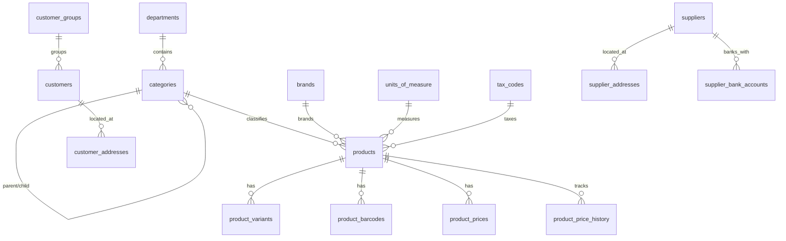

# MAGIC ERP — PHASE B: COMMERCIAL MASTERS & PRODUCTS
## Master Implementation Plan & Architectural Blueprint

**Document Version:** 1.0.0  
**Phase:** Phase B (Commercial Masters & Products)  
**Target Modules:**  
- Module 1: Product Master & Pricing Engine  
- Module 2: Category, Brand & Department Hierarchy  
- Module 3: Customer & Party Master  
- Module 4: Vendor & Supplier Master  
**Technology Stack:** .NET 10 + EF Core 10 + PostgreSQL 18 + Angular 22  
**Status:** AUTHORIZED FOR EXECUTION  

---

## 1. Architectural Objectives & Invariants

Phase B delivers the authoritative commercial master data foundation for MAGIC ERP. It provides the structured entities, business validation, pricing tiers, and tax classifications required by retail POS, commercial B2B sales, purchasing, inventory, and automated general ledger integration.

### Core Invariants Enforced:
1. **Financial Correctness:** All monetary fields (`SellingPrice`, `CostPrice`, `PurchasePrice`, `MRP`, `MinSellingPrice`, `CreditLimit`) are stored as 64-bit signed integers (`BIGINT` in PostgreSQL, `long` paise in C#). Zero floating-point arithmetic.
2. **Statutory Tax Integrity:** Products link to standard Indian GST slabs (0%, 0.1%, 0.25%, 3%, 5%, 12%, 18%, 28%) and statutory HSN/SAC codes. Customers and Suppliers validate 15-character GSTIN checksums and state code consistency.
3. **Identity & Uniqueness:** SKUs, barcodes, customer codes, and supplier codes are strictly unique within each tenant company. Duplicate detection prevents collisions across variants and aliases.
4. **Data Protection & Banking Security:** Supplier bank account numbers are encrypted at rest using AES-256-GCM. Normal UI responses deliver masked representations (`•••• •••• 1234`). Only authorized administrative roles with `commercial:suppliers:bank-details` may access plaintext numbers.
5. **No Premature Transactions:** Master data registration does NOT post fake vouchers or fabricated inventory balances. Linkages to General Ledger control accounts (`11300 Accounts Receivable`, `21100 Accounts Payable`) are established for future transactional workflows.
6. **Workspace Isolation:** All screens are housed exclusively inside the **Billing Workspace** (`/billing/*`). The top-centre switcher and existing Accounting workspace remain untouched.

---

## 2. Implementation Sub-Stage Breakdown

Phase B is executed in 5 strictly controlled, verifiable sub-stages:

```
┌─────────────────────────────────────────────────────────────────────────────┐
│                          PHASE B EXECUTION ROADMAP                           │
└─────────────────────────────────────────────────────────────────────────────┘
                                      │
  ┌───────────────────────────────────┼───────────────────────────────────┐
  ▼                                   ▼                                   ▼
[Sub-Stage B1]                  [Sub-Stage B2]                  [Sub-Stage B3]
Product Master & Pricing        Category, Brand & Dept          Customer & Party Master
- Units of Measure              - Hierarchical Categories       - Customer Profiles & Types
- Tax Codes & HSN               - Brands Directory              - GSTIN & PAN Validation
- Product Aggregate Root        - Departments Management        - Address & Contact Management
- Variants & Barcodes           - Tree Navigation               - Credit Limits & Groups
- Multi-tier Price Lists        - Safe Reassignment Engine      - AR Control Account Mapping
  │                                   │                                   │
  └───────────────────────────────────┼───────────────────────────────────┘
                                      │
                                      ▼
                                [Sub-Stage B4]
                           Vendor & Supplier Master
                           - Supplier Profiles & MSME
                           - Encrypted Bank Accounts
                           - Payment Terms & Credit
                           - AP Control Account Mapping
                                      │
                                      ▼
                                [Sub-Stage B5]
                     Integration, Verification & Polish
                     - Full Angular UI Integration
                     - 100+ Automated Tests
                     - Complete Phase B Documentation Suite
```

---

## 3. Database Schema Overview: `commercial`

All Phase B tables reside in a dedicated PostgreSQL schema: `commercial`.



---

## 4. Security & Granular RBAC Permissions

The following permissions are registered in `security.permissions` and bound to standard roles:

| Permission Code | Module | Description | Admin | StoreManager | Accountant | Cashier |
|:---|:---|:---|:---:|:---:|:---:|:---:|
| `commercial:products:view` | Commercial | View product catalog and details | ✅ | ✅ | ✅ | ✅ |
| `commercial:products:create` | Commercial | Register new products and variants | ✅ | ✅ | ❌ | ❌ |
| `commercial:products:edit` | Commercial | Edit product specs and pricing | ✅ | ✅ | ❌ | ❌ |
| `commercial:products:archive` | Commercial | Archive or deactivate products | ✅ | ❌ | ❌ | ❌ |
| `commercial:categories:manage` | Commercial | Manage categories, brands, departments | ✅ | ✅ | ❌ | ❌ |
| `commercial:pricing:manage` | Commercial | Update price lists and discount tiers | ✅ | ✅ | ❌ | ❌ |
| `commercial:customers:view` | Commercial | View customer directory and details | ✅ | ✅ | ✅ | ✅ |
| `commercial:customers:manage` | Commercial | Create and edit customer profiles | ✅ | ✅ | ❌ | ❌ |
| `commercial:credit:approve` | Commercial | Modify customer credit limits | ✅ | ❌ | ✅ | ❌ |
| `commercial:suppliers:view` | Commercial | View vendor directory and terms | ✅ | ✅ | ✅ | ❌ |
| `commercial:suppliers:manage` | Commercial | Create and edit vendor profiles | ✅ | ✅ | ❌ | ❌ |
| `commercial:suppliers:bank-details` | Commercial | Access unmasked vendor bank accounts | ✅ | ❌ | ✅ | ❌ |

---

## 5. Deliverables & Definition of Done

1. **Database:** 16 PostgreSQL tables in `commercial` schema with indexes, foreign keys, and unique constraints applied to both `magic_dev` and `magic_test`.
2. **Backend Services & APIs:**
   - Products API: CRUD, SKU generator, barcode manager, tiered pricing.
   - Categories, Brands & Departments API: Hierarchy traversal, safe deletion.
   - Customers API: Registration, GSTIN validation, credit profiles, addresses.
   - Suppliers API: Registration, encrypted bank accounts, MSME tracking.
3. **Frontend UI:** 4 full enterprise workspaces inside `/billing/*`:
   - Products & Price Lists (`/billing/products`)
   - Categories & Brands (`/billing/categories`)
   - Customers & Parties (`/billing/customers`)
   - Suppliers & Vendors (`/billing/suppliers`)
4. **Testing:** Domain unit tests, integration tests, and Vitest component tests with 100% pass rate.
5. **Documentation:** Full 7-document Phase B suite.

