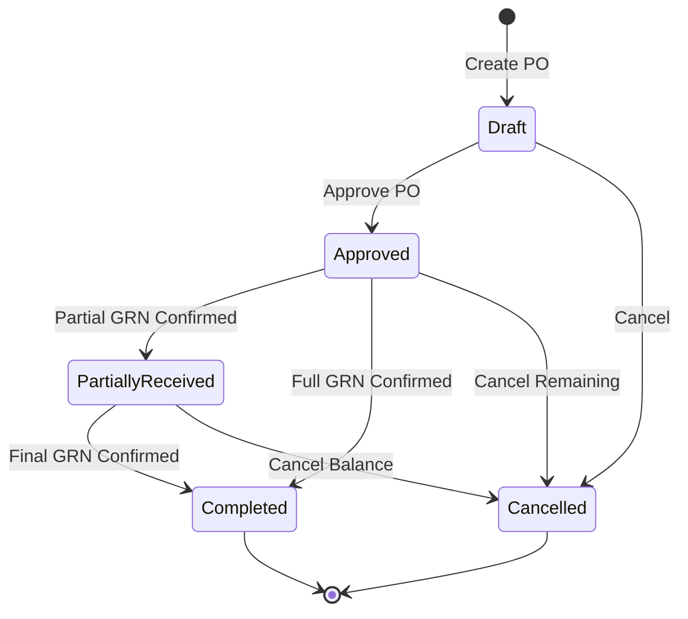

# MAGIC ERP — Phase C: Inventory & Procurement Architectural Specification

**System:** MAGIC — Universal Business Management ERP  
**Module Subsystem:** Inventory & Procurement (Phase C)  
**Architecture:** Modular Monolith, Domain-Driven Design (DDD), Clean Architecture  
**Runtime:** .NET 10, ASP.NET Core, EF Core 10, PostgreSQL 18, Angular 22  

---

## 1. Domain Overview & Invariants

Phase C establishes the operational heartbeat of MAGIC ERP, connecting Commercial Master Data (Phase B) to physical stock fulfillment, vendor supply chains, and multi-location warehouse operations.

### Core Domain Invariants:
1. **Immutable Movement Ledger as Source of Truth:**
   Stock balances are *never* directly edited by arbitrary updates. Every physical change in inventory is driven by an append-only `StockMovement` event in `inventory.stock_movements`.
2. **Atomic Balance Projection (`inventory.stock_balances`):**
   A dedicated balance table maintains real-time projections (`OnHand`, `Reserved`, `Available`, `Damaged`, `Expired`, `Blocked`) updated atomically inside the same PostgreSQL ACID transaction that writes the movement record.
3. **Strict Prevention of Negative Stock:**
   Available stock deductions (Sales, Transfers Out, Negative Adjustments, Purchase Returns) must check available balances and reject any operation that would result in negative available inventory (`Available = QuantityOnHand - QuantityReserved - QuantityDamaged - QuantityBlocked`).
4. **Separation of Commercial Commitments from Physical Stock:**
   - A Purchase Order (PO) is a commercial contract with a supplier; it **never** increases inventory balances.
   - Inventory is increased **only** when a Goods Receipt Note (GRN) is formally confirmed and inspected.
   - Similarly, a Purchase Return reduces inventory **only** upon formal confirmation.
5. **Two-Phase Transfer Mechanics (Dispatch & Receive):**
   - Stock transfers across warehouses or branches require dispatch from source (reducing source available stock and putting stock into an in-transit state) followed by an independent receipt confirmation at the destination warehouse.
   - Duplicate dispatches and duplicate receipts are prevented by optimistic concurrency and state machine invariants.
6. **DEC-ACC-002 Valuation Boundary:**
   In compliance with accounting decision `DEC-ACC-002`, FIFO vs. Moving Weighted Average remains open. Phase C tracks exact physical quantities, batch numbers, expiry dates, and source transaction receipt costs in integer paise (`BIGINT`), but **freezes** automated inventory valuation journal postings to the General Ledger until the accounting board ratifies the valuation policy.

---

## 2. Subsystem State Machines

```mermaid
stateDiagram-v2
    [*] --> DraftTransfer : Create Transfer Request
    DraftTransfer --> ApprovedTransfer : Supervisor Approval
    ApprovedTransfer --> Dispatched : Dispatch (Stock leaves source, becomes In-Transit)
    Dispatched --> PartiallyReceivedTransfer : Discrepancy / Damaged in transit
    Dispatched --> Received : Destination Confirmation (Stock enters destination)
    PartiallyReceivedTransfer --> Received : Balance resolved
    DraftTransfer --> CancelledTransfer : Cancel
    ApprovedTransfer --> CancelledTransfer : Cancel before dispatch
    Received --> [*]
    CancelledTransfer --> [*]
```

---

## 3. Storage Location Hierarchy

Warehouses support multi-tier storage location zoning:
- **Warehouse** (`inventory.warehouses`)
  - **Zone / Aisle** (`inventory.storage_locations` - Parent)
    - **Rack** (`inventory.storage_locations` - Middle)
      - **Shelf / Bin** (`inventory.storage_locations` - Leaf location)
- **Product-to-Location Mappings** (`inventory.product_storage_locations`) allow designating primary picking bins and secondary overflow locations per product/variant.

---

## 4. Multi-Tenant and Branch Isolation

All entities inherit:
- `CompanyId` (UUID) — Partitioned strictly per tenant. All queries enforce `CompanyId` derived server-side from JWT claims.
- `BranchId` (UUID) — Warehouses are assigned to branches (`inventory.warehouse_branch_assignments`). Users assigned to specific branches can access only warehouses linked to their branches, unless holding company-wide administrative permissions.

