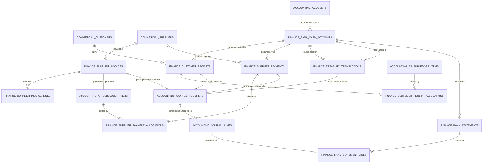

# MAGIC ERP — PHASE E: ENTITY RELATIONSHIP DIAGRAM (ERD)

**Project:** MAGIC – Universal Business Management ERP  
**Phase:** E — Financial Management & Treasury  

---

## 2. Cross-Schema Foreign Key Integrity

1. `finance.customer_receipts.voucher_id` ──► `accounting.journal_vouchers.id` (RESTRICT)
2. `finance.customer_receipt_allocations.ar_item_id` ──► `accounting.ar_subledger_items.id` (RESTRICT)
3. `finance.supplier_invoices.voucher_id` ──► `accounting.journal_vouchers.id` (RESTRICT)
4. `finance.supplier_payments.voucher_id` ──► `accounting.journal_vouchers.id` (RESTRICT)
5. `finance.supplier_payment_allocations.ap_item_id` ──► `accounting.ap_subledger_items.id` (RESTRICT)
6. `finance.bank_cash_accounts.gl_account_id` ──► `accounting.accounts.id` (RESTRICT)
7. `finance.treasury_transactions.voucher_id` ──► `accounting.journal_vouchers.id` (RESTRICT)
8. `finance.bank_statement_lines.matched_voucher_line_id` ──► `accounting.journal_lines.id` (SET NULL)
