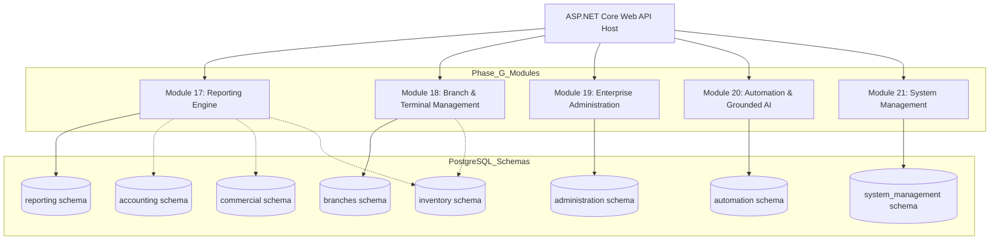

# MAGIC ERP — PHASE G: ENTERPRISE ARCHITECTURE SPECIFICATION
## Enterprise Intelligence, Multi-Branch, Administration, AI Automation & System Management

**Project:** MAGIC — Universal Business Management ERP  
**Phase:** G — Enterprise & Operations Finalization  
**Architecture:** Modular Monolith / Clean Architecture / DDD  
**Backend:** ASP.NET Core (.NET 10), Entity Framework Core 10, Npgsql  
**Frontend:** Angular 22, TypeScript, Angular CDK, SCSS  
**Database:** PostgreSQL 18 Local (`magic_dev` and `magic_test`)  

---

### 1. Executive Architectural Summary

Phase G completes the planned core enterprise scope of MAGIC ERP by delivering Modules 17 through 21:
- **Module 17: Reports & Advanced Business Intelligence (`reporting` schema)**: Unified executive KPIs across all operational subsystems (Sales, POS, Purchases, Inventory, GL, HR, Payroll), provisional status isolation for DEC-ACC-002 (FIFO valuation), and streaming CSV/PDF report export.
- **Module 18: Multi-Branch & Multi-Terminal Management (`branches` schema)**: Company profile maintenance, branch physical site registry, POS terminal registration, hardware telemetry, cashier assignment, and double-entry inter-branch inventory transfers.
- **Module 19: Enterprise Administration & Security Governance (`administration` schema)**: Administrative user management, RBAC role-permission matrix, multi-tier transactional approval workflows with separation-of-duties enforcement, and immutable security audit logs.
- **Module 20: Automation & AI Business Assistant (`automation` schema)**: Rule-based event automation engine, real-time in-app notification center, and data-grounded AI assistant executing typed LINQ queries within strict tenant boundaries without raw SQL execution.
- **Module 21: System Management & Platform Operations (`system_management` schema)**: Health telemetry, SHA-256 database backup engine, isolated restore validation, EF Core migration tracking, background worker monitoring, and secret redaction (`***REDACTED***`).

---

### 2. Subsystem Bounded Contexts & Schema Partitioning

Phase G preserves strict modular monolith isolation by isolating database structures into dedicated PostgreSQL 18 schemas:

---

### 3. Core Principles Maintained

1. **Monetary Integrity**: All financial amounts are strictly signed 64-bit integers (`long` in C# / `bigint` in PostgreSQL) representing paise. Floating-point types are prohibited.
2. **Accounting Ledger as Single Truth**: No reporting, branch transfer, or operational decision bypasses the General Ledger or creates shadow balances.
3. **Provisional Accounting Decision Labeling**: Unresolved DEC-ACC-002 (FIFO vs Moving Weighted Average valuation) is prominently labeled provisional across all executive summaries and reporting models.
4. **Tenant Isolation**: Every query filters by `CompanyId` derived strictly from authenticated JWT user claims (`ResolveCompanyId()`).
5. **No Raw SQL Execution**: The Grounded AI assistant processes natural-language intents via typed LINQ queries over `MagicDbContext` entities without raw SQL execution or LLM prompt injection vectors.
6. **Authentication Freeze**: Pre-existing login, password hashing, and token issuing subsystems remain intact without modification.

