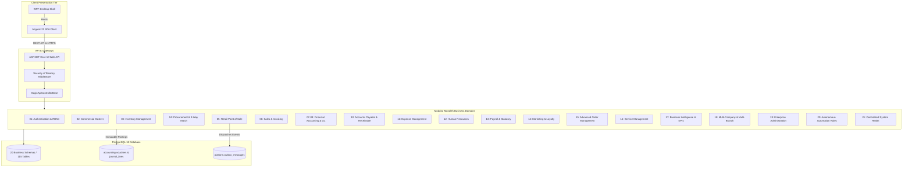

# Magic

## Universal Business Management ERP System

[](https://dotnet.microsoft.com/)
[](https://angular.dev/)
[](https://www.postgresql.org/)
[](https://learn.microsoft.com/en-us/dotnet/csharp/)
[](https://developer.microsoft.com/en-us/microsoft-edge/webview2/)
[](#)
[](#)

---

### Overview

**MAGIC** is a next-generation Universal Business Management ERP engineered for enterprise retail, wholesale, manufacturing, and multi-branch operations. Built from the ground up on modern, production-grade foundations:

- **Backend:** C# / ASP.NET Core 10 Web API, Entity Framework Core 10 / Npgsql, PostgreSQL 18.
- **Frontend:** Angular 22 (Signals, Standalone Components, CDK, Custom SCSS Design System).
- **Desktop:** Windows Presentation Foundation (WPF) with Microsoft Edge WebView2 & Win32 ESC/POS raw hardware printing.
- **Architecture:** Modular Monolith, Clean Architecture, Domain-Driven Design (DDD), Strict Tenancy Isolation, Transactional Outbox Pattern.

---

### Architecture & System Design



---

### Complete 21-Module Suite

| Phase | Module # | Domain Name | Core Responsibilities |
|:---:|:---:|---|---|
| **A** | **1** | **Authentication & Security** | JWT tokens, refresh rotation, RBAC permissions, terminal security. |
| **B** | **2** | **Commercial Masters** | Customers, suppliers, price lists, tax rules, product catalog, encrypted bank details. |
| **C** | **3** | **Inventory Management** | Multi-warehouse tracking, stock transfers, physical counts, reorder rules. |
| **D** | **4** | **Procurement** | Purchase orders, Goods Receipt Notes (GRN), supplier returns, 3-way matching. |
| **E** | **5** | **Point of Sale (POS)** | Cashier shifts, barcode scanning, loyalty accrual, coupon redemption, tender splitting. |
| **E** | **6** | **Sales & Invoicing** | B2B billing, e-way bills, customer debit notes, GST-compliant invoicing. |
| **E** | **7–9** | **Financial Accounting & GL** | Double-entry posting engine, balanced journal vouchers, Chart of Accounts, trial balance. |
| **E** | **10** | **Financial Management (AR/AP)** | Subledgers, customer receipts, supplier disbursements, bank statement reconciliations. |
| **F** | **11** | **Expense Management** | Employee claims, petty cash management, multi-level approvals, GL posting. |
| **F** | **12** | **Human Resource Management** | Employee records, attendance, leave balances, departmental hierarchies. |
| **F** | **13** | **Payroll Management** | Salary structures, payslip generation, tax deductions, disbursement vouchers. |
| **F** | **14** | **Marketing & Growth** | Coupon campaigns, customer loyalty tiers, point accrual & sales return reversals. |
| **F** | **15** | **Advanced Order Management** | Customer sales orders, pick/pack/ship fulfillment, backorder tracking. |
| **F** | **16** | **Service Management** | Support tickets, work orders, AMC contracts, spare parts inventory deduction. |
| **G** | **17** | **Business Intelligence & BI** | Real-time executive dashboards, branch profitability, sales trends, inventory turnover. |
| **G** | **18** | **Multi-Company & Multi-Branch** | Multi-tenant organization hierarchies, branch-scoped warehouses, synchronized POS terminals. |
| **G** | **19** | **Enterprise Administration** | User role matrices, approval workflows, tamper-evident audit logs. |
| **G** | **20** | **Workflow Automation & AI** | Autonomous background rule evaluation, low-stock alerts, natural language assistant. |
| **G** | **21** | **Centralized System Management** | Diagnostic health telemetry, automated PostgreSQL backups, maintenance mode. |

---

### Key Financial & Engineering Invariants

1. **Integer Paise Storage:** All monetary values are strictly stored as signed 64-bit integers (`long` in C#, `bigint` in PostgreSQL) representing paise (₹1 = 100 paise), completely eliminating floating-point rounding drift.
2. **Immutable General Ledger:** Database triggers reject any direct `UPDATE` or `DELETE` on posted vouchers and journal lines with PostgreSQL exception `55000`. Reversals generate companion offsetting vouchers.
3. **Strict Tenancy Isolation:** Signed JWT tokens govern company and branch scoping. Tampered `X-Company-Id` headers are rejected with HTTP 403 Forbidden.
4. **Transactional Outbox Pattern:** Outbox messages (`sales.invoice.created`, `sales.return.created`) are atomically committed with business data, processed by background workers, and delivered with idempotent consumer guarantees.
5. **Native ESC/POS Printing:** Direct Win32 `winspool.drv` P/Invoke bindings allow raw thermal paper cutting, barcode generation, and cash drawer kicks on retail counters.

---

### Project Repository Structure

```text
├── 00-DOCUMENTATION/             # Complete audit reports, architectural specifications & diagrams
│   ├── COMPLETE_SYSTEM_AUDIT/    # 21 audit dossiers and defect registers
│   ├── PHASE_G/                  # Phase G enterprise modules documentation
│   └── PRODUCTION_READINESS/     # 12 formal production readiness verification reports
├── 01-SRC/                       # Application source code
│   ├── Backend/
│   │   ├── Magic.Domain/         # Core business entities, value objects & domain logic
│   │   ├── Magic.Application/    # Use cases, application services & interfaces
│   │   ├── Magic.Infrastructure/ # EF Core 10, PostgreSQL 18, Outbox & Background Services
│   │   ├── Magic.Platform/       # Cross-cutting platform concerns & security utilities
│   │   └── Magic.Api/            # ASP.NET Core 10 Controllers & Web API host
│   ├── Contracts/
│   │   └── Magic.Contracts/      # DTOs, API request/response models & shared contracts
│   ├── Desktop/
│   │   └── Magic.Desktop.Wpf/    # WPF Desktop application with WebView2 & Win32 hardware bridge
│   └── Frontend/                 # Angular 22 Single Page Application
│       ├── src/app/core/         # Interceptors, guards, base services & models
│       ├── src/app/features/     # Billing, Accounting, Commercial, POS, Enterprise feature modules
│       └── src/app/layouts/      # Shell, sidebar, mode-switching & header navigation
└── 03-TESTS/                     # Automated test suites (263 total tests)
    ├── Unit/
    │   └── Magic.Domain.UnitTests/       # Domain logic unit tests (36 tests)
    ├── Architecture/
    │   └── Magic.ArchitectureTests/     # ArchUnitNET layer boundary tests (4 tests)
    └── Integration/
        └── Magic.Api.IntegrationTests/  # End-to-end API integration tests (145 tests)
```

---

### Getting Started

#### Prerequisites
- **.NET 10 SDK** (v10.0.100+)
- **Node.js** (v22+) & **npm** (v11+)
- **PostgreSQL 18** running on `localhost:5432`

#### 1. Database Setup
Create the development and test databases:
```bash
createdb -h localhost -p 5432 -U postgres magic_dev
createdb -h localhost -p 5432 -U postgres magic_test
```

#### 2. Run Backend Web API
```bash
cd "01-SRC/Backend/Magic.Api"
dotnet run --launch-profile Magic.Api.Http
# Listening on http://127.0.0.1:5000
```

#### 3. Run Frontend Development Server
```bash
cd "01-SRC/Frontend"
npm install
npm start
# Available at http://localhost:4200 (proxies /api to localhost:5000)
```

#### 4. Run Automated Test Suite
```bash
# Backend test suite (185 tests)
dotnet test Magic.sln

# Frontend test suite (78 tests)
npm --prefix 01-SRC/Frontend test -- --watch=false
```

---

### Verification & Testing Metrics

- **Backend Tests:** 185 / 185 Passed (`Magic.Domain.UnitTests`, `Magic.ArchitectureTests`, `Magic.Api.IntegrationTests`).
- **Frontend Tests:** 78 / 78 Passed (39 Spec files).
- **Total Tests:** **263 / 263 Passed (100% Pass Rate, Exit Code: 0)**.
- **Frontend Production Build:** Succeeded (1.55 MB optimized distribution bundle).
- **Desktop WPF Build:** Succeeded with 0 Warnings and 0 Errors.
- **Database Restore:** Verified with 100% schema and table parity (20 schemas, 115 tables).

---

### License

Proprietary enterprise software developed for MAGIC Universal Business Management ERP. All rights reserved.
